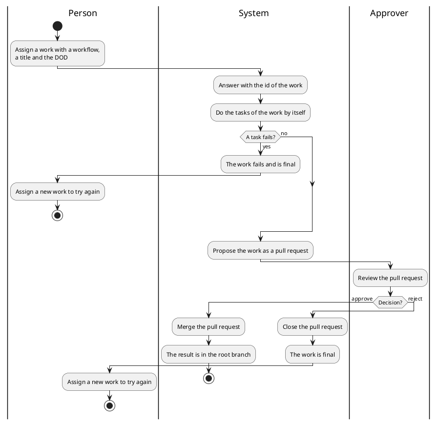

# Use cases

What the actors want from `superteam`, and what they get. It is a spec, not a
design: it treats the system as a black box, so it says what the system does for
an actor and what the actor sees, and never how the system does it. The design
is in `05_building-blocks/` (the structure) and in `06_runtime/` (what happens
over time).

Each use case is realized by one or more scenarios of
`06_runtime/action-flow.md`.

## Actors

- **The person who assigns:** sets up the project, gives a work, and follows it.
- **The approver:** reviews the work, and decides. It is a person or a bot.
- **The worker:** does the tasks. It is a person or an AI, and for now every
  task is done by an AI agent.

## UC1. Set up the project

- **Actor:** the person who assigns.
- **Goal:** the project has its workflows and its roles of Claude.
- **Main scenario:**
  1. The person asks the system to create the roles of Claude, and the workflows
     of the project.
  2. The system writes the agent files, the workflows and the port of the API,
     and adds the runtime folder and the file of the environment variables to
     the `.gitignore` of the project. It writes nothing else.
- **Extension:** the person runs it again when the data of the project changes.
  A line of the `.gitignore` is added only if it is missing, so running it again
  changes nothing else.
- **Result:** the workflows are kept in git, and the runtime data and the values
  of the environment variables are not.

## UC2. Give a work and get the result

- **Actor:** the person who assigns, and the approver.
- **Goal:** a work is done, and its result is in the root branch.
- **Precondition:** the project is set up (UC1), and superteam is started with
  `/superteam:start`.
- **Main scenario:**
  1. The person assigns a work with a workflow, a title, and optionally an id, a
     description and a DOD. The system answers with the `id` of the work.
  2. The system does the tasks of the work by itself.
  3. The person follows the work: gets its state, or the list of the works. The
     system also notifies the people when something happens.
  4. When all the tasks are done, the system proposes the work as a pull
     request, and its status is `PROPOSED`.
  5. The approver reviews the work in the pull request, and decides to approve
     it.
  6. The system merges the pull request, and the result is in the root branch.
- **Extensions:**
  - The body of the request is not valid: the system refuses it.
  - The workflow does not exist: the system refuses it.
  - The id of the work is already used: the system refuses it. So assigning the
    same work twice with the same id creates one work.
  - A task fails: the whole work fails, and the tasks that have not started
    never start. The work is final.
  - The approver rejects the work: the pull request is closed, and the work is
    final.
  - The decision is sent for a work that is not `PROPOSED`: the system refuses
    it.
- **Result:** an approved work has its result in the root branch. A failed work
  and a rejected work are final: to try again, the person assigns a new work.

## UC3. Archive a work

- **Actor:** the person who assigns.
- **Goal:** a work that failed or was rejected is no longer listed.
- **Precondition:** the work is final and was not approved (UC2).
- **Main scenario:**
  1. The person asks the system to archive the work.
  2. The system removes the trace of the work, and the work is no longer listed.
- **Extension:** the work did not fail and was not rejected: the system refuses
  it.
- **Result:** the work is no longer listed. The pull request of a rejected work
  stays closed on the forge.
