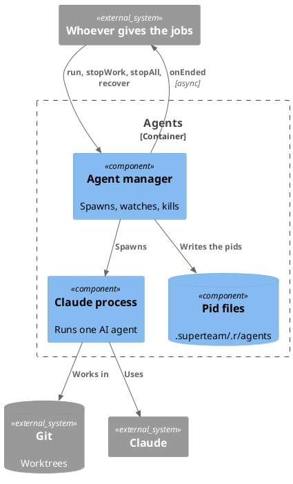

# Agents

Manages the AI agents that do the jobs of a work, as the worker of a task or as
the merger. The root branch is the branch of the root workspace.

The documents of its components: `agent-manager.md` for the processes, and
`claude-process.md` for the `claude` command.

## Component

- It runs the agents of the jobs that it is given. A job has a role, the worker
  of a task or the merger, and the worktree where it runs. It does not know who
  gives it the jobs.
- Its functions:

  | Function            | What it does                                                                                                     |
  | ------------------- | ---------------------------------------------------------------------------------------------------------------- |
  | `run(job, onEnded)` | Spawns the agent of the job in its worktree, and returns at once. When the job ends, it calls `onEnded(result)`. |
  | `stopWork(workId)`  | Stops all the jobs of a work at once, to save the cost.                                                          |
  | `stopAll()`         | Stops all the jobs, at a shutdown.                                                                               |
  | `recover()`         | At the start, kills the processes that a crash left, and returns their jobs.                                     |

- The result of a job is the result of its agent, or the error that ended it:
  the process fails, it is killed because it runs too long, or its result does
  not match the schema.

## Code

### The merger

The merger is run for the unit of the work. It merges the branches of the
dependencies of a task into the new branch when the task has more than one, and
merges the branches of the final tasks. It does all the merges of the work.

A conflict can happen only when it merges the dependencies of a task. The merger
resolves the conflict itself, so the worker starts on a clean worktree.

The merger is a role of the engine, not of the project. Its agent file comes
with the plugin, and the Seed Skill does not create it (see `seed-skill.md`).

The failure of the merger is handled like the failure of a worker.

### The worker

The steps of one task, when the worker runs (the worktree and the branch of the
task are given, see `git-adapter.md`):

1. The agent manager spawns the worker process in the folder of the worktree.
2. The agent manager records the pid of the worker process and watches it (see
   `agent-manager.md`).
3. The worker runs the task and commits its changes to the branch. It only works
   in the worktree and on the branch that it is given. The branch is kept on the
   remote, where the results are stored.

### Merging the final tasks

The changes are not merged into the root branch when the worker finishes. When
all the tasks of a work are done, the merger merges the branches of all the
final tasks of the work, the tasks at the end of the dependency chain, into the
branch of the work, in the worktree of the work. There can be more than one such
branch, so this merge is needed. Opening the pull request, and the approval, are
not done here.

### Help with code

What code can do is not left to the worker. There are two ways to give it that
help, and both are kept open:

- A standalone script that the worker runs, such as the creation of an artifact
  (see "Artifacts" in `persistence-data.md`). It needs no other part: it works
  on the files and on git in the worktree.
- A stateless API, which only computes for the worker. It keeps no state, and
  the worker calls it over HTTP. There is no use case for it yet.
