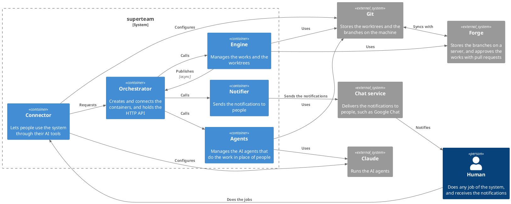

# Building blocks

`superteam` is made of four containers, and the orchestrator above them:

- **Engine:** manages the works and the worktrees. It keeps its runtime files
  following the data contract, and uses Git and the forge. It is active: it runs
  its loop, takes the requests through its functions, and tells its state to the
  outside through pub/sub. It does not know who uses them.
- **Connector:** lets people use the system through their AI tools.
- **Agents:** manages the AI agents that do the work in place of people. It is a
  service: it runs the agent of a job when it is called, and it calls back when
  the job ends.
- **Notifier:** sends the notifications to people. It is a service: it sends a
  message when it is called, and it does not know where the message comes from.

The containers do not know each other, and they do not call each other (see the
principles in `solution-strategy.md`). The orchestrator is one level above them
(see `orchestrator.md`). It creates the Engine, the Agents and the Notifier, it
is the only consumer of the interfaces of the containers, and it holds the only
door of the system, the HTTP API. The Connector is loaded by the AI tool of a
person, with its session, and it reaches the system only through the HTTP API.
It holds no logic: it decides whom to call, when, and with which input. For
example, it runs in the Agents the job that the Engine asks for, and gives its
result back to the Engine.

The data is not a container. `storage.md` is the data contract: the paths and
the entities that the containers follow when they read or write data. The
runtime files are inside the container that owns them, and follow the contract.

