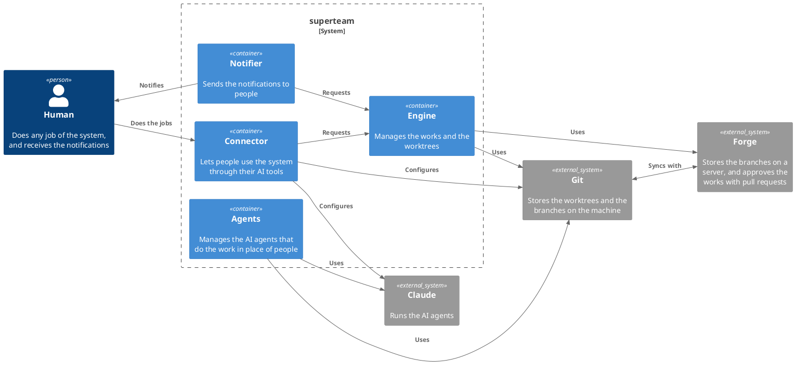

# Building blocks

`superteam` is made of four parts:

- **Engine:** manages the works and the worktrees. It keeps its runtime files
  following the data contract, and uses Git and the forge. It provides an HTTP
  API and pub/sub, and it does not know who uses them. It needs a job runner to
  run the jobs, and it is given one.
- **Connector:** lets people use the system through their AI tools.
- **Agents:** manages the AI agents that do the work in place of people. It runs
  the agents of the jobs that it is given, and it calls back when a job ends.
- **Notifier:** sends the notifications to people. It acts on the topics that it
  knows, and it does not know where they come from.

The containers do not know each other. The orchestrator of `superteam`, which is
above the containers, creates them and connects them. When it creates a
container, it gives it what the container needs, as an interface that the
container defines: for example, it gives the Engine the Agents as its job
runner. It also subscribes the Notifier to the topics of the Engine.

The data is not a container. `storage.md` is the data contract: the paths and
the entities that the containers follow when they read or write data. The
runtime files are inside the container that owns them, and follow the contract.

