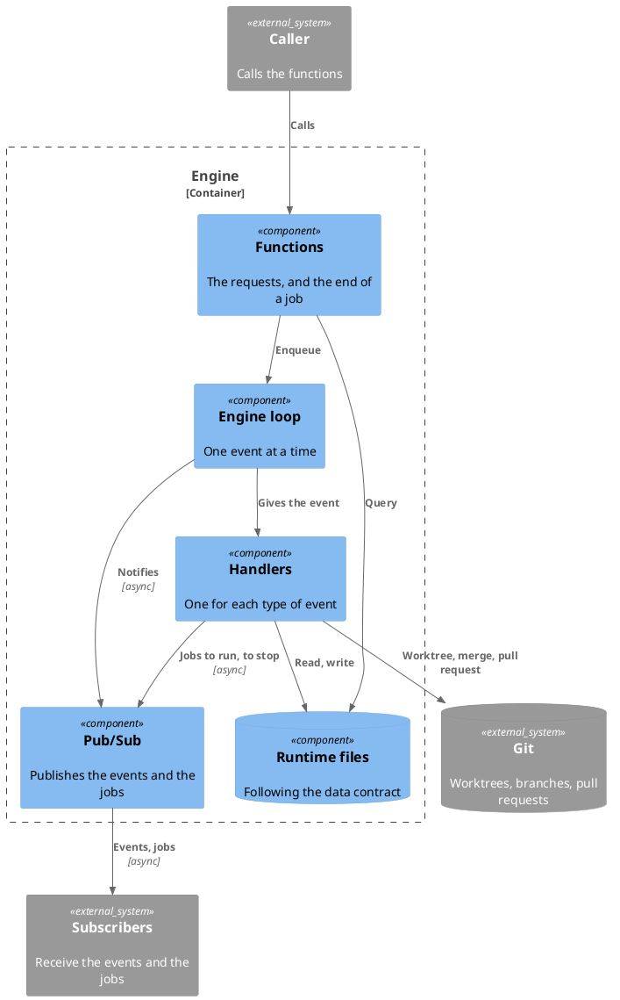

# Engine

The engine is the team lead (see the README): it takes a work, and gives back
the output of the work. It does four things:

- It takes the requests for a work.
- It splits a work into tasks.
- It publishes the events of the works and the tasks, to whoever subscribes. It
  does not know who they are.
- It reports the results, and takes the requests to approve or to reject a work.
- It asks for the jobs to run, and takes their results.

## Component

The engine provides two interfaces. Everything else is inside:

- Its functions: the requests, at the level of the work, and the end of a job
  (see "Functions").
- `pubsub.md`: how the engine tells its state to the outside, such as its events
  and the jobs to run.

The engine does not know who calls its functions, and it does not know who
receives its notifications. It does not call another container.

### Functions

| Function                     | What it does                                                                                                                                                                                                                                                                                                                                                                                                                                                                                         |
| ---------------------------- | ---------------------------------------------------------------------------------------------------------------------------------------------------------------------------------------------------------------------------------------------------------------------------------------------------------------------------------------------------------------------------------------------------------------------------------------------------------------------------------------------------- |
| `assign(body)`               | Checks the body, fetches, then checks that the root branch has an upstream on `origin`, that the workflow exists on it and that the id is not used yet, enqueues `work:assign` with the name of that upstream branch as `base`, and returns the `id` of the work, given or created, and the `eventId`.                                                                                                                                                                                               |
| `decide(id, decision)`       | Checks that the work is `PROPOSED`, enqueues `work:decide`, and returns the `eventId`.                                                                                                                                                                                                                                                                                                                                                                                                               |
| `archive(id)`                | Checks that the work is `FAILED` or `REJECTED`, enqueues `work:archive`, and returns the `eventId`.                                                                                                                                                                                                                                                                                                                                                                                                  |
| `retry(id)`                  | Checks that the work has an error of the engine that is `retryable`, puts its event back in the queue from the DLQ, removes the error, and returns the `eventId` (see ADR 16).                                                                                                                                                                                                                                                                                                                       |
| `getWork(id)`                | Returns the state of a work, from the runtime state and from git, without the loop.                                                                                                                                                                                                                                                                                                                                                                                                                  |
| `listWorks()`                | Returns the list of the works, without the loop.                                                                                                                                                                                                                                                                                                                                                                                                                                                     |
| `jobEnded(result)`           | Enqueues `worker:ended`, `task-merger:ended` or `work-merger:ended`, from the kind in the id of the job, with the result of the job.                                                                                                                                                                                                                                                                                                                                                                 |
| `reconcile(jobs)`            | At the start, takes the jobs that were killed, and enqueues `engine:reconcile`, so it runs after the events that were left in the queue. Its handler rebuilds from the disk the jobs that the engine waits for: it fails the tasks of the killed jobs, and publishes `job:run` again for a job that it waits for and that was never run. It also fails again a failed work whose worktree is left, and starts the ready tasks of a running work that have no worktree. It logs a work that it skips. |
| `subscribe(topic, callback)` | Calls the callback for each notification of the topic (see `pubsub.md`), and returns a function that unsubscribes.                                                                                                                                                                                                                                                                                                                                                                                   |
| `start()`, `shutdown()`      | Starts the engine loop, and stops it gracefully (see "Life cycle" in `engineloop.md`). Before the loop starts, it adds `.superteam/.r/` to the exclude file of the git common dir. When the start stage is done, the engine publishes `engine:ready`.                                                                                                                                                                                                                                                |

A function that refuses a request says why: the body is not valid, the work or
the workflow does not exist, the data of the workflow is corrupted ("corrupted
workflow data": its file is not valid JSON, or the upstream of the root branch
is not on `origin`), the request does not fit the state of the work, the engine
is starting, the root branch has no upstream on `origin` or HEAD is detached, or
git or gh failed (offline, no origin, gh signed out). When the fetch fails,
`assign` refuses the request, because a work starts from the latest upstream,
and `getWork` and `listWorks` read the local refs, with a warning. The engine
reads the workflows from the upstream of the root branch, and an approved work
from the branch on which its pull request was merged, or from the upstream of
the root branch when that branch no longer has it, never from the files of the
root workspace (see ADR 15).

A job is one run of an AI agent for a work. It has these fields:

| Field         | What it holds                                                                                                                                                                                                                                                                                                                                                     |
| ------------- | ----------------------------------------------------------------------------------------------------------------------------------------------------------------------------------------------------------------------------------------------------------------------------------------------------------------------------------------------------------------- |
| `id`          | `{workId}/{taskId}/{kind}` for a job of a task, where the kind is `worker` or `task-merger`, and `{workId}/work-merger` for the job of the work. It is the same each time that the job is published, so a job that already runs is not run again. The ids of a work and of a task are slugs, so the engine reads the work and the task of a job back from its id. |
| `role`        | The role of the agent: the `assignee` of the task for a worker, or `task-merger` or `work-merger`.                                                                                                                                                                                                                                                                |
| `timeout`     | The maximum time of the run, in minutes: the `timeout` of the task for a worker, or 720 for a merger.                                                                                                                                                                                                                                                             |
| `workdir`     | The folder where the agent runs: the worktree of the task, or the worktree of the work. Its branch comes with it.                                                                                                                                                                                                                                                 |
| `schema`      | The JSON schema of the result, from the entity TASK or WORK.                                                                                                                                                                                                                                                                                                      |
| `instruction` | `{ target, targetIds, prompt }`. `target` is `task` for a worker, with the id of its task in `targetIds`; `merge` for a task merger, with the tasks to merge; and `work` for the work merger, with the id of the work. The engine makes the `prompt`.                                                                                                             |

The result of a job is the result of its agent, `{ summary, data }`, or the
error that ended it:

| Job                  | `summary`                                                                                                          | `data`                                                                                 |
| -------------------- | ------------------------------------------------------------------------------------------------------------------ | -------------------------------------------------------------------------------------- |
| The worker of a task | What the worker did, in its own words. The engine writes it in the task.                                           | An object TASK (see `storage.md`), with the `dodChecklist` that the worker fills.      |
| The task merger      | What the task merger merged, and the conflicts that it resolved. The engine writes it in the task, for its worker. | An object TASK. Nothing of it is written.                                              |
| The work merger      | What the work merger merged, and the conflicts that it resolved. The engine puts it in the pull request.           | An object WORK (see `storage.md`), with the `dodChecklist` that the work merger fills. |

The engine merges into the task or the work only the fields that the job may
write: `dodChecklist`. The other fields belong to the engine, and the engine
keeps them. The schema that is given to the agent comes from the entity of
`data`, TASK or WORK.

### Parts

The runtime files are inside the engine, and they follow the data contract (see
`runtime-data.md`).

## Code

The documents of its inner components, and of the data contract that it follows:

- `engineloop.md`: the loop that processes the events of the engine.
- `handlers.md`: the handlers, one for each type of event.
- `git-adapter.md`: how the engine reaches git and the forge, and the worktrees.
- `storage.md`: the data contract: the entities, and where the data is kept.

The engine runs in the root workspace. There is only one engine instance for a
workspace. It has no UI and runs on its own. The git worktrees created for the
jobs have no engine.
