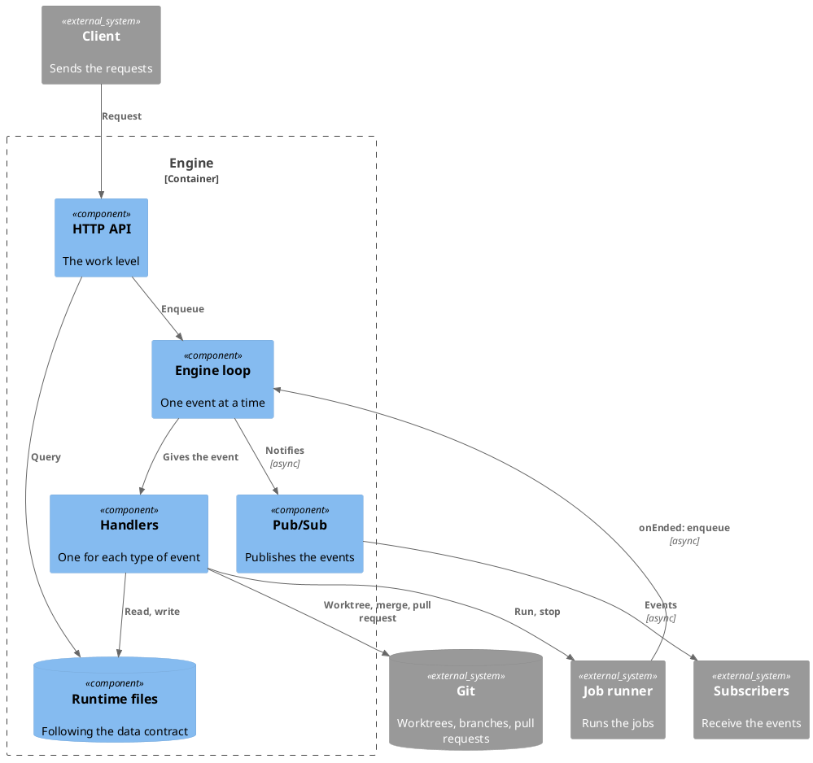

# Engine

The engine is the team lead (see the README): it takes a work, and gives back
the output of the work. It does four things:

- It takes the requests for a work.
- It splits a work into tasks.
- It publishes the events of the works and the tasks, to whoever subscribes. It
  does not know who they are.
- It reports the results, and takes the requests to approve or to reject a work.

## Component

The engine provides two interfaces, and needs one. Everything else is inside:

- `http-api.md`: the only door for the requests, at the level of the work.
- `pubsub.md`: how the engine publishes its events.
- The job runner, which the engine needs (see "Dependencies").

The engine does not know who sends the requests, and it does not know who
receives its events.

### Dependencies

The engine does not run the jobs itself, and it does not know who does. It needs
a **job runner**. The engine defines it as an interface, and it is given to the
engine when the engine is created. The engine is the side that starts a job and
waits for its result, so the result comes back by a callback: the other side
does not need an interface to call the engine.

| Function            | What the engine needs from it                                                                                                                            |
| ------------------- | -------------------------------------------------------------------------------------------------------------------------------------------------------- |
| `run(job, onEnded)` | Starts the job, in the worktree that the engine gives, and returns at once. When the job ends, it calls `onEnded(result)`. The engine enqueues an event. |
| `stopWork(workId)`  | Stops all the jobs of a work at once, such as when the work fails.                                                                                       |
| `stopAll()`         | Stops all the jobs, at the shutdown.                                                                                                                     |
| `recover()`         | At the start, stops the jobs that a crash left, and returns them. The engine fails their tasks.                                                          |

A job has a role (the worker of a task, or the merger), the worktree where it
runs, and what it has to do. The names and the fields are a proposal.

### Parts

The runtime files are inside the engine, and they follow the data contract (see
`runtime-data.md`).

## Code

The documents of its inner components, and of the data contract that it follows:

- `engineloop.md`: the loop that processes the events of the engine.
- `handlers.md`: the handlers, one for each type of event.
- `git-adapter.md`: how the engine reaches git and the forge, and the worktrees.
- `storage.md`: the data contract: the entities, and where the data is kept.

The engine is one process, in the root workspace. There is only one engine
instance for a workspace. It has no UI and runs on its own. The git worktrees
created for the jobs have no engine.
