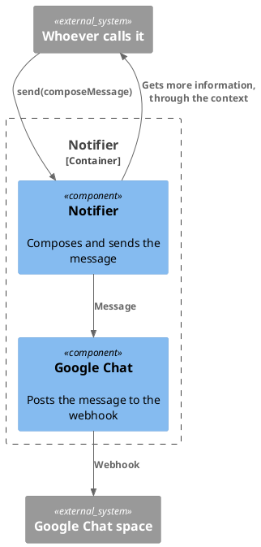

# Notifier

Sends the notifications to people. It is a service: it sends a message when it
is called, and it does not know where the message comes from.

## Component

- `send(composeMessage)`: it calls `composeMessage()` to get the message, and
  sends it to people through a channel. For now the only one is Google Chat (see
  `google-chat.md`).
- `composeMessage(event, context)`: builds the message for an event of a work or
  a task. It is a callback: the caller runs it in its own context, and gives it,
  in `context`, the access that it needs to get more information, such as
  `getWork`. It does not know where the access comes from.

## Code

`composeMessage` may use the `context` to get more information for the message,
such as the state of the work. The Notifier does not call another container
itself.
