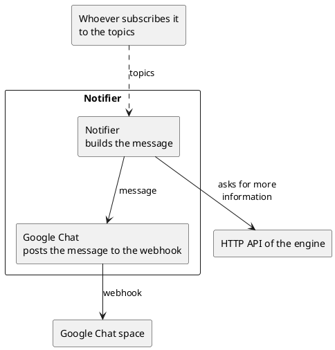

# Notifier

Sends the notifications to people. It is a subscriber (see `pubsub.md`): it acts
on the topics that it knows, and it does not know where they come from.

## Component

- It receives the topics about the changes of a work or a task.
- It builds a message for each topic that it acts on, and sends it to people
  through a channel. For now the only one is Google Chat (see `google-chat.md`).

## Code

When a topic arrives, it may call the HTTP API to get more information for the
message (see `http-api.md`).
