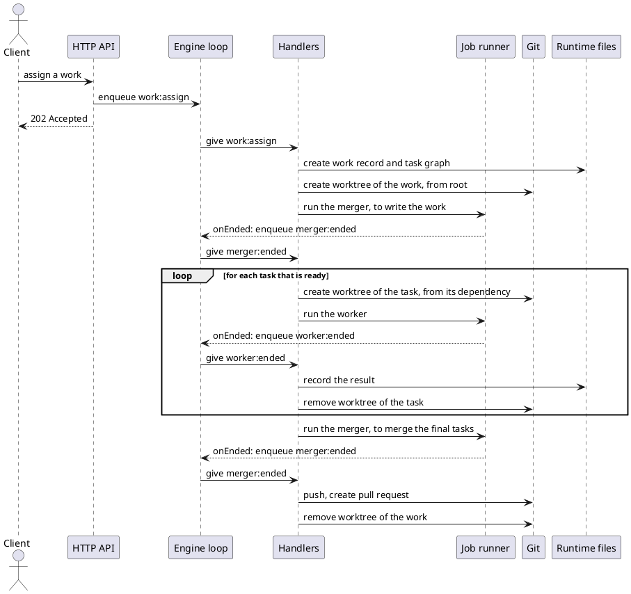
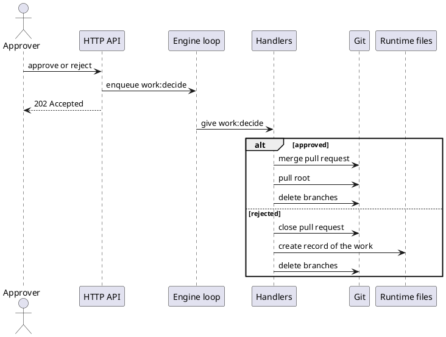
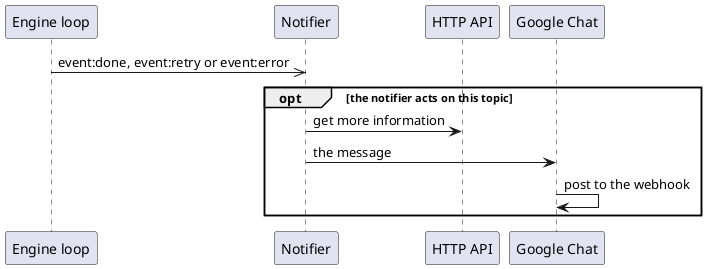

# Action flow

The order of the actions that the parts of the system do for one scenario, and
which part does each action. It is a dynamic view: the documents of the levels
in `05_building-blocks/` describe the structure, and this one describes what
happens over time.

The rules of this document:

- A scenario says which use case of `01_introduction/use-cases.md` it realizes.
- A scenario says which parts it passes through, with the document of each part.
  It does not describe a part: the interface of a part is in its own document.
- A step is one action of one part. How the part does it inside is in the
  document of the part.
- A scenario does not contradict the documents of the parts. If it needs
  something that a part does not provide, the part is changed first.

## Parts

| Part                    | Container | Document                        |
| ----------------------- | --------- | ------------------------------- |
| HTTP API                | Engine    | `http-api.md`                   |
| Engine loop             | Engine    | `engineloop.md`                 |
| Handlers                | Engine    | `handlers.md`                   |
| Pub/Sub                 | Engine    | `pubsub.md`                     |
| Git adapter             | Engine    | `git-adapter.md`                |
| Runtime files           | Engine    | `runtime-data.md`               |
| Job runner (the Agents) | Agents    | `agents.md`, `agent-manager.md` |
| Claude process          | Agents    | `claude-process.md`             |
| MCP server              | Connector | `mcp-server.md`                 |
| Notifier, Google Chat   | Notifier  | `notifier.md`, `google-chat.md` |

## Assign and run a work

Realizes: UC2, steps 1, 2 and 4 (see `01_introduction/use-cases.md`).

Passes through: the HTTP API, the engine loop, the handlers, the git adapter,
the runtime files, and the job runner with the Claude process.

1. **Assign.** A client assigns a work to the engine with one request. The
   engine records that the work was given to it, creates the tasks of the work
   from the steps of its workflow, with no other request, and creates the
   worktree of the work, based on the root branch. It runs the merger in it, to
   write the work from its runtime record.
2. **Run.** The engine runs the tasks by itself: a task starts when it has its
   inputs, which means that its status is `IN_PROGRESS` (see "Derived status" in
   `storage.md`). For each task the engine creates a worktree and a branch,
   based on the branch of the task it depends on. If the task depends on more
   than one task, the engine runs the merger first, to merge the branches of the
   other dependencies into the new branch. Then the engine runs a worker in the
   worktree. The worker works only in its worktree, and its results are kept on
   its branch, which is on the remote. When the worker ends, the engine records
   the result.
3. **Propose.** When all the tasks are done, the engine runs the merger, to
   merge the branches of the final tasks into the worktree of the work. When the
   merger has ended, the engine pushes the branch of the work, and opens a pull
   request, so the work is `PROPOSED`. The description of the pull request is a
   Markdown text that holds the DOD checklists of the tasks.

## Decide a work

Realizes: UC2, steps 5 and 6, and the extension of the rejection.

Passes through: the HTTP API, the engine loop, the handlers, the git adapter,
and the runtime files.

1. **Decide.** The approver reviews the work in the pull request, and sends the
   decision to the API: approved or rejected. The decision is not stored: the
   merge of the pull request into the root branch is the approval, and the git
   history keeps it. So the work and the engine stay clean, and approving is one
   atomic action, with nothing else to update. If the work is rejected, the
   engine closes the pull request, creates a record of the work in the runtime
   storage, and deletes all the branches of the work. A rejected work is final:
   to try again, a new work is assigned.
2. **Merge.** When the work is approved, the engine merges the pull request into
   the root branch, as rebase and squash. This merge is the approval. The engine
   then pulls the root branch, so the root workspace has the result, and deletes
   all the branches of the work (its own branch and the branches of its tasks),
   so that they do not pile up.

## A job fails

Realizes: UC2, the extension of a task that fails.

Passes through: the job runner with the Claude process, the engine loop, the
handlers, the git adapter, and the runtime files.

A task is not run again. If its worker fails (the process fails, it is killed
because it runs too long, or its result does not match the schema), the whole
work fails, and the tasks that have not started never start. The engine asks the
job runner to stop the other jobs of the work at once, to save the cost. A
failure of the merger fails the work in the same way. The engine then removes
the worktrees of the work, deletes all its branches, and keeps its record in the
runtime storage. A failed work is final, like a rejected one: to try again, a
new work is assigned. A failed task is recorded as `completed` with an `error`,
so it is `FAILED` (see "Derived status" in `storage.md`).

## Start and shutdown

Realizes: no use case. It is the operation of the engine.

Passes through: the engine loop, the job runner (see "Recover" and "Shutdown" in
`agent-manager.md`), and the HTTP API.

1. **Start:**
   1. Start the engine loop, with the handlers registered. Its start stage
      recovers the events that were left (see `engineloop.md`).
   2. Call `recover()` of the job runner, and enqueue an event that the job has
      failed for each job that it returns. The jobs that a crash left would be
      stalled, because the engine no longer waits for them. This step handles a
      crash and a shutdown in the same way.
   3. Open the HTTP API, after the start stage of the engine loop is done,
      because `enqueue()` needs it.
2. **Run:** the API turns the requests into events, and the engine loop gives
   them to the handlers.
3. **Shutdown:** on `SIGINT` or `SIGTERM` the engine stops taking requests,
   calls `stopAll()` of the job runner, and shuts the engine loop down. The jobs
   that were stopped are failed at the next start, so their works fail. A second
   signal is a force quit, and the next start recovers from it.

## Notify

Realizes: UC2, step 3.

Passes through: the engine loop, the pub/sub, the notifier, the HTTP API, and
Google Chat.

1. The engine loop fires a notification (`event:done`, `event:retry` or
   `event:error`) with the event, and calls its subscribers in the order of
   their subscription. It does not wait for them (see `pubsub.md`).
2. The notifier acts only on the topics that it knows. For such a topic it may
   ask the HTTP API for more information, and it builds the message.
3. The notifier gives the message to Google Chat, which posts it to the webhook
   of its space. If it fails or is too slow, the event is skipped, and it is not
   retried (see `google-chat.md`).

