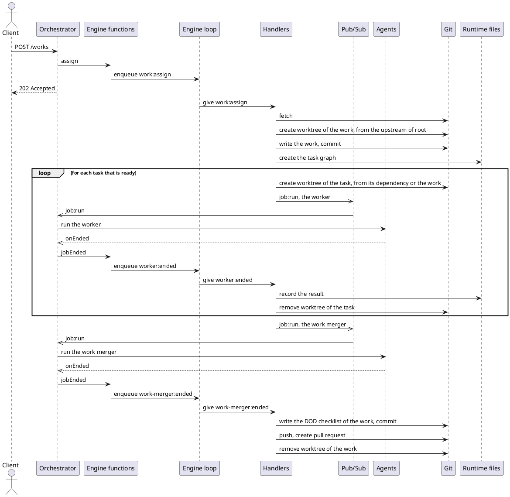
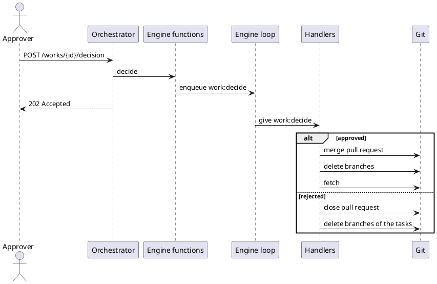
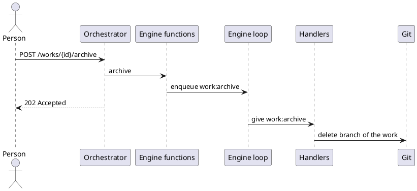
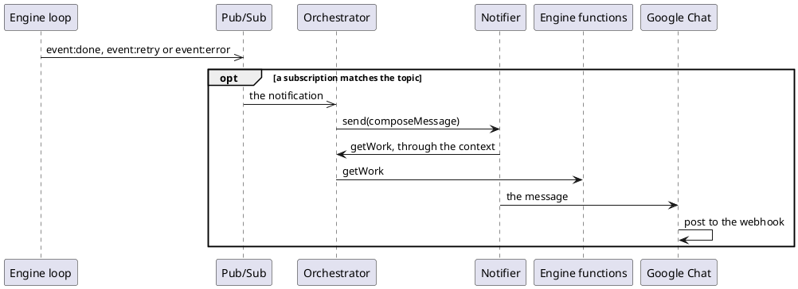

# Action flow

The order of the actions that the parts of the system do for one scenario, and
which part does each action. It is a dynamic view: the documents of the levels
in `05_building-blocks/` describe the structure, and this one describes what
happens over time.

The rules of this document:

- A scenario says which use case of `01_introduction/use-cases.md` it realizes.
- A scenario says which parts it passes through, with the document of each part.
  It does not describe a part: the interface of a part is in its own document.
- A step is one action of one part. How the part does it inside is in the
  document of the part.
- A scenario does not contradict the documents of the parts. If it needs
  something that a part does not provide, the part is changed first.

## Parts

| Part                            | Container              | Document                        |
| ------------------------------- | ---------------------- | ------------------------------- |
| Orchestrator, with the HTTP API | None, it is above them | `orchestrator.md`               |
| Engine functions                | Engine                 | `engine.md`                     |
| Engine loop                     | Engine                 | `engineloop.md`                 |
| Handlers                        | Engine                 | `handlers.md`                   |
| Pub/Sub                         | Engine                 | `pubsub.md`                     |
| Git adapter                     | Engine                 | `git-adapter.md`                |
| Runtime files                   | Engine                 | `runtime-data.md`               |
| Agents                          | Agents                 | `agents.md`, `agent-manager.md` |
| Claude process                  | Agents                 | `claude-process.md`             |
| MCP server                      | Connector              | `mcp-server.md`                 |
| Notifier, Google Chat           | Notifier               | `notifier.md`, `google-chat.md` |

## Assign and run a work

Realizes: UC2, steps 1, 2 and 4 (see `01_introduction/use-cases.md`).

Passes through: the orchestrator with the HTTP API, the engine functions, the
engine loop, the handlers, the pub/sub, the git adapter, the runtime files, and
the Agents with the Claude process.

1. **Assign.** A client assigns a work to the engine with one request. The
   engine fetches, and creates the worktree of the work, based on the upstream
   of the root branch (see ADR 15). It writes the work in it, from the request,
   with the name of that upstream branch in `base`, and commits it on the branch
   of the work. Then it creates the tasks of the work from the steps of its
   workflow, with no other request, in the runtime of the worktree of the work.
2. **Run.** The engine runs the tasks by itself: a task starts when it has its
   inputs, which means that its status is `IN_PROGRESS` (see "Derived status" in
   `storage.md`). For each task the engine creates a worktree and a branch,
   based on the branch of the task it depends on, or on the branch of the work
   for a task with no dependency. If the task depends on more than one task, the
   engine asks for the task merger first, to merge the branches of the other
   dependencies into the new branch. Then the engine asks for a worker in the
   worktree, with `job:run`, and the orchestrator runs it in the Agents. The
   worker works only in its worktree, and its results are kept on its branch,
   which is on the remote. When the worker ends, the orchestrator gives the
   result to the engine, which records it.
3. **Propose.** When all the tasks are done, the engine asks for the work
   merger, to merge the branches of the final tasks into the worktree of the
   work. When the work merger has ended, the engine writes its DOD checklist in
   the work and commits it, pushes the branch of the work, and opens a pull
   request on the `base` of the work, so the work is `PROPOSED`. The description
   of the pull request is a Markdown text that holds the `summary` of the work
   merger, the DOD checklist of the work, and the DOD checklists of the tasks,
   because the tasks are removed with the worktree of the work.

## Decide a work

Realizes: UC2, steps 5 and 6, and the extension of the rejection.

Passes through: the orchestrator with the HTTP API, the engine functions, the
engine loop, the handlers, and the git adapter.

1. **Decide.** The approver reviews the work in the pull request, and sends the
   decision to the API: approved or rejected. The decision is not stored: the
   merge of the pull request into the root branch is the approval, and the git
   history keeps it. So the work and the engine stay clean, and approving is one
   atomic action, with nothing else to update. If the work is rejected, the
   engine closes the pull request, and deletes the branches of the tasks of the
   work. The branch of the work is kept on the remote, as the trace of the work.
   A rejected work is final: to try again, a new work is assigned.
2. **Merge.** When the work is approved, the engine merges the pull request into
   the root branch, as a squash merge. This merge is the approval. The engine
   then deletes all the branches of the work (its own branch and the branches of
   its tasks), so that they do not pile up, and fetches, so that it reads the
   result from the `base` of the work. It does not pull the root branch into the
   root workspace: the person pulls it when they want the result there (see ADR
   15).

## A job fails

Realizes: UC2, the extension of a task that fails.

Passes through: the Agents with the Claude process, the orchestrator, the engine
functions, the engine loop, the handlers, the pub/sub, the git adapter, and the
runtime files.

A task is not run again. If its worker fails (the process fails, it is killed
because it runs too long, or its result does not match the schema), the whole
work fails, and the tasks that have not started never start. The engine
publishes `job:stop`, and the orchestrator asks the Agents to stop the other
jobs of the work at once, to save the cost. A failure of a merger fails the work
in the same way. The engine then writes the `error` in the work, commits it, and
pushes the branch of the work, which is kept on the remote as the trace of the
work. It removes the worktrees of the work, which removes its tasks too, and
deletes the branches of its tasks. A failed work is final, like a rejected one:
to try again, a new work is assigned. A failed task is recorded as `completed`
with an `error`, so it is `FAILED` (see "Derived status" in `storage.md`).

## Archive a work

Realizes: UC3 (see `01_introduction/use-cases.md`).

Passes through: the orchestrator with the HTTP API, the engine functions, the
engine loop, the handlers, and the git adapter.

1. **Archive.** The person asks the API to archive a work that failed or was
   rejected. The engine checks that the work is `FAILED` or `REJECTED`, and
   enqueues the event.
2. **Delete.** The engine checks the state of the work again, and deletes the
   branch of the work, on the remote and on this machine. The work is no longer
   listed. The pull request of a rejected work stays closed on the forge.

## Start and shutdown

Realizes: no use case. It is the operation of the system.

Passes through: the Control Skill, the orchestrator, the engine functions, the
engine loop, the handlers, the git adapter, and the Agents (see "Recover" and
"Shutdown" in `agent-manager.md`).

1. **Start:** `/superteam:start` starts the process of superteam in the
   background (see `control-skill.md`). Then the orchestrator:
   1. Loads `.superteam/.env` into the environment, checks `SUPERTEAM_PORT` and
      `SUPERTEAM_MAX_BUDGET_USD`, and creates the Engine, the Agents and the
      Notifier.
   2. Checks that the project has a git remote named `origin`, and that `gh` is
      signed in. Otherwise it refuses to start.
   3. Subscribes to the engine: `engine:ready`, `job:run`, `job:stop`, and the
      topic of each subscription. It does it first, so that no job to run is
      lost.
   4. Calls `recover()` of the Agents, which kills the agents that a crash left,
      and keeps the jobs that it returns. It does it before the engine starts,
      so that it does not kill the agents just spawned for the events that were
      left in the queue.
   5. Starts the engine loop, with the handlers registered. Before it, the
      engine adds `.superteam/.r/` to the exclude file of the git common dir.
      The start stage of the loop recovers the events that were left (see
      `engineloop.md`).
   6. When the engine publishes `engine:ready`, gives the jobs of the step 4 to
      `reconcile(jobs)` of the engine. The engine enqueues `engine:reconcile`,
      so it runs after the events that were left in the queue. Its handler fails
      the tasks of these jobs, and publishes `job:run` again for a job that it
      waits for and that was never run. The jobs that a crash left would be
      stalled, because the engine no longer waits for them. This step handles a
      crash and a shutdown in the same way.
   7. Opens the HTTP API, after `engine:ready`, because `enqueue()` needs the
      start stage to be done.
2. **Run:** the API calls the engine functions, which turn the requests into
   events, and the engine loop gives them to the handlers.
3. **Shutdown:** on `SIGINT` or `SIGTERM`, such as from `/superteam:stop`, the
   orchestrator stops taking requests, calls `stopAll()` of the Agents, and
   shuts the engine down. Once the shutdown has begun, the orchestrator does not
   run a `job:run`: the engine publishes it again at the next start, in
   `reconcile(jobs)`. The jobs that were stopped are failed at the next start,
   so their works fail. A second signal is a force quit, and the next start
   recovers from it.

## Notify

Realizes: UC2, step 3.

Passes through: the engine loop, the pub/sub, the orchestrator, the notifier,
the engine functions, and Google Chat.

1. The engine loop fires a notification (`event:done`, `event:retry` or
   `event:error`) with the event. The pub/sub calls the subscribers of its
   topic, in the order of their subscription, and does not wait for them (see
   `pubsub.md`).
2. The orchestrator subscribed with the topic of a subscription that names the
   notifier (see "Subscriptions" in `orchestrator.md`). It calls
   `send(composeMessage)` of the notifier.
3. The notifier calls `composeMessage`, which builds the message. It may get
   more information through its context, such as `getWork` of the engine.
4. The notifier gives the message to Google Chat, which posts it to the webhook
   of its space. If it fails or is too slow, the event is skipped, and it is not
   retried (see `google-chat.md`).

