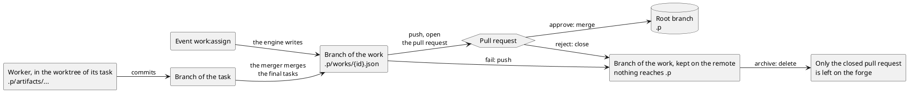
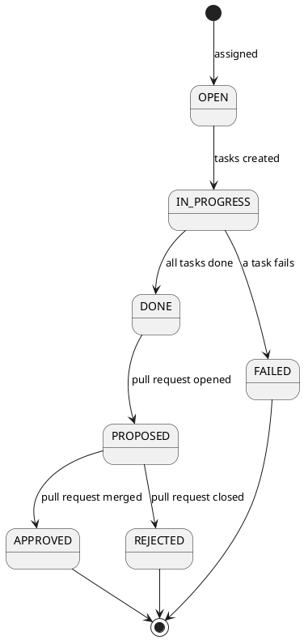

# Data flow

Where each piece of data is created, where it is read, and how it moves from one
place to another over time. It is a dynamic view: `storage.md` is the contract
of the data (the entities and the paths), and this document follows the data
through the system.

The rules of this document are those of `action-flow.md`: it points to the
documents of the parts, and it does not describe a part.

## Where the data is

| Data           | Where                                                             | Created by                                                   | Read by                                                                                                                            |
| -------------- | ----------------------------------------------------------------- | ------------------------------------------------------------ | ---------------------------------------------------------------------------------------------------------------------------------- |
| Workflow       | `.superteam/.p/workflows/{name}.json`                             | The Seed Skill (see `seed-skill.md`)                         | The engine, when it assigns a work                                                                                                 |
| Role of Claude | `.claude/agents/{role}.md`                                        | The Seed Skill. The merger's file comes with the plugin      | The Claude process (see `claude-process.md`)                                                                                       |
| Task           | `.superteam/.r/tasks/{task_id}.json`, in the worktree of the work | The handlers of the engine                                   | The handlers. The API, to derive the status of a work                                                                              |
| Work           | `.superteam/.p/works/{id}.json`                                   | The engine, in the worktree of the work (see `handlers.md`)  | The handlers, to build the prompts and to survive a restart. The API. Whoever reads the root branch, such as the list of the works |
| Artifact       | `.superteam/.p/artifacts/{work_id}/{id}.json`                     | A script that the worker runs, in the worktree of its task   | Whoever reads the root branch, and the tasks that depend on its task                                                               |
| Pid and job    | `.superteam/.r/agents/{pid}.pid`                                  | The agent manager (see `agent-manager.md`)                   | The agent manager, to recover after a crash                                                                                        |
| Events         | `.superteam/.r/engineloop/`                                       | The engine loop (see `engineloop.md`)                        | The engine loop                                                                                                                    |
| Worktrees      | `.superteam/.r/worktrees/`                                        | The handlers, through the git adapter (see `git-adapter.md`) | The jobs that run in them                                                                                                          |

## How the persistence data reaches the root branch

The engine does not create persistence data directly (see the principles in
`solution-strategy.md`). It is created in a worktree, kept on a branch, and it
reaches the root branch only when the pull request of the work is merged.

## Status of a work

The work status and the approval status are two separate statuses (see "Derived
status" in `storage.md`). Put in order, they make the whole life of a work, from
the moment it is assigned to its final result.

