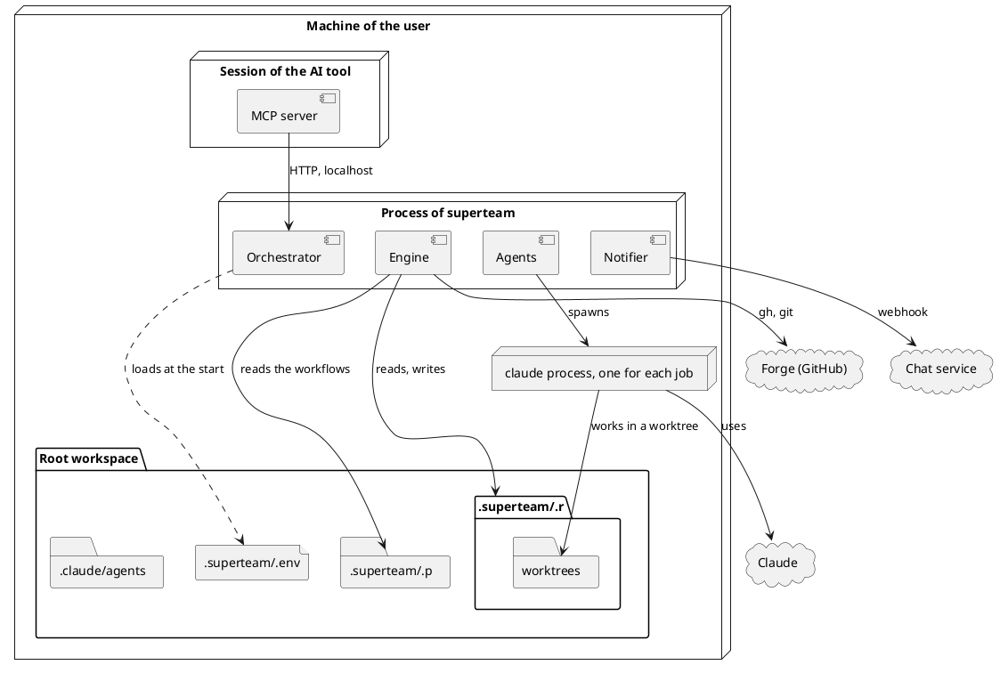

# Deployment

Where the parts of the system run, and what a workspace must hold before the
system runs. The diagram is a deployment diagram of UML.

## Where the parts run

- The orchestrator and the Engine, the Agents and the Notifier run in one
  process, in the root workspace (see `orchestrator.md`).
- The MCP server starts with the session of the AI tool, and calls the HTTP API
  on localhost (see `mcp-server.md`).
- The Agents spawn one `claude` process for each job, in the worktree of the job
  (see `agent-manager.md`).
- The worktrees are folders under `.superteam/.r/worktrees/`, and their branches
  are kept on the forge (see `git-adapter.md`).

## What a workspace must hold

| What                     | How it is prepared                                                                                                                                                                                                                                                                                                        | Who                                                                                             |
| ------------------------ | ------------------------------------------------------------------------------------------------------------------------------------------------------------------------------------------------------------------------------------------------------------------------------------------------------------------------- | ----------------------------------------------------------------------------------------------- |
| The plugin               | `superteam` is installed in the AI tool. It brings the MCP server, the skills, and the agent files of the mergers. It must be installed in Claude Code, because the `claude` process of a job finds the agent files of the mergers only through the installed plugin. Otherwise `--agent task-merger` is not found.       | A person                                                                                        |
| `node`                   | Node.js 22 or later is installed, because the plugin runs its scripts and its MCP server with it.                                                                                                                                                                                                                         | A person                                                                                        |
| `claude`                 | The `claude` command is installed and signed in, with the account that pays for the runs (see `claude-process.md`).                                                                                                                                                                                                       | A person                                                                                        |
| `gh`                     | The `gh` command is installed and signed in with `gh auth login`, with an account that can write to the repository. `gh auth setup-git` lets git push with the same account. The remote of the repository is on GitHub, and it is named `origin`. The root branch tracks a branch on `origin`, its upstream (see ADR 15). | A person                                                                                        |
| The repository           | It allows the kind of merge that the engine uses, the squash merge (see `git-adapter.md`). A person who merges a pull request on GitHub uses the squash merge too (see ADR 17). The protection of the root branch lets the account merge a pull request, because the merge is the approval, and delete a branch.          | A person                                                                                        |
| `.superteam/.env`        | It holds `SUPERTEAM_PORT`, `SUPERTEAM_MAX_BUDGET_USD` when the cost is limited, and the values of the environment variables that the subscriptions name, such as `SUPERTEAM_GCHAT_WEBHOOK` (see `constraints.md`). It is not kept in git.                                                                                 | The Seed Skill writes `SUPERTEAM_PORT`. A person writes the other values.                       |
| The initial data         | The workflows in `.superteam/.p/workflows/`, the roles in `.claude/agents/`, and the optional `.superteam/.p/config.json` (see ADR 18) (see "Initial data" in `persistence-data.md`). They are committed on the root branch and pushed, because the worktrees are checked out from its upstream (see ADR 15).             | The Seed Skill writes them, and a person commits and pushes them.                               |
| The `.gitignore`         | It holds `.superteam/.r/` and `.superteam/.env`. It is committed on the root branch and pushed, like the initial data. The engine also adds `.superteam/.r/` to the exclude file of the git common dir at the start, so a worktree never commits the runtime data.                                                        | The Seed Skill writes it, and a person commits and pushes it. The engine adds the exclude line. |
| The subscriptions        | The config files of the orchestrator. Where they are kept is not decided yet (see `risks-and-debts.md`).                                                                                                                                                                                                                  | A person                                                                                        |
| The process of superteam | `/superteam:start` starts it in the background, and `/superteam:stop` stops it (see `control-skill.md`).                                                                                                                                                                                                                  | A person                                                                                        |
