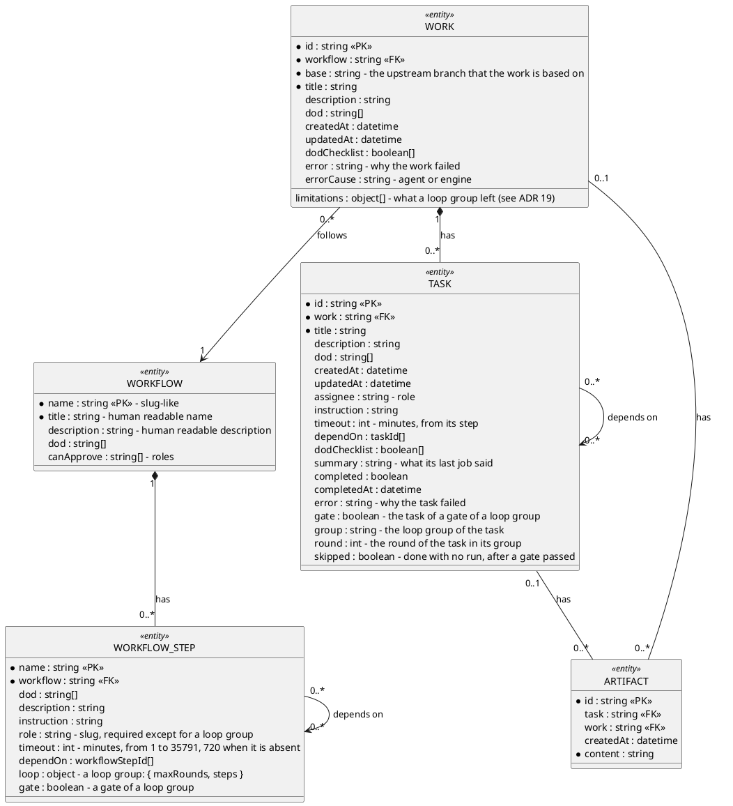

# Data contract

The agreement on where the data is kept, and on the entities that it holds. It
is not a container: the containers follow it when they read or write data, and
the runtime files are inside the container that owns them.

The data is file-based, under `{baseDir}/.superteam/`, where `baseDir` is the
root workspace, the place where the engine runs. The data has two kinds (see the
principles in `solution-strategy.md`), and each kind has one folder:

| Folder           | Kind        | In git |
| ---------------- | ----------- | ------ |
| `.superteam/.p/` | Persistence | Yes    |
| `.superteam/.r/` | Runtime     | No     |

An entity is one JSON file, and its path comes from its identity.

The file `.superteam/.env` is not data: it holds the values of the environment
variables, and it is not kept in git (see `constraints.md`).

The persistence data is in `persistence-data.md`, and the runtime data is in
`runtime-data.md`.

## Data structure

The diagram is a class diagram of UML. A field whose name starts with `*` is
required. A filled diamond is a composition: the part does not exist without the
whole, such as a task without its work.

### Entity design

Entities are isolated: each one works on its own. An entity does not hold data
that is written back by an entity that refers to it, and the references between
entities never form a circle. So it is rare that more than one actor writes the
same entity.

### Identity

| Entity   | `id`                                                                                                                                                                                                               |
| -------- | ------------------------------------------------------------------------------------------------------------------------------------------------------------------------------------------------------------------ |
| WORK     | A slug, such as `add-login-page`: lowercase letters and digits, in words joined by `-`, up to 63 characters. The client can give it. Otherwise the engine creates a random one, of 8 lowercase letters and digits. |
| TASK     | The `name` of its step, or `{group}-{step}-{round}` for a step of a loop group (see ADR 19). It is unique in the work, and a slug of at most 63 characters.                                                        |
| ARTIFACT | A hash (see "The id of an artifact" in `persistence-data.md`).                                                                                                                                                     |

The `id` of a work is in the name of its branch, in the path of its file and in
the URL of the API, so it must be safe for all three. An `id` is used while one
of these is left: an assign of it that is accepted and not processed yet, the
branch `{prefix}-work/{id}`, or a pull request from that branch (see ADR 18). An
approved work, whose file is in `.superteam/.p/works/` on the branch it was
merged on, always has its merged pull request. The engine refuses a work whose
`id` is used, so a work that is assigned twice with the same `id` is created
once. A work that failed and was archived leaves nothing, so its `id` can be
used again. A rejected work leaves its closed pull request, so its `id` cannot.

### Roles

A role names a job. There are two kinds of role (see the principles in
`solution-strategy.md`):

- **The roles of the engine:** the assigner, the approver, the task merger and
  the work merger. The engine defines them.
- **The roles of the project:** such as the developer and the business analyst.
  The project defines them.

The fields `WORKFLOW_STEP.role`, `TASK.assignee` and `WORKFLOW.canApprove` hold
the names of roles. A job of a role can be done by a person or by an AI. So the
approver is a person or a bot.

### Loop groups

A step of a workflow can be a loop group (see ADR 19):
`{ name, dependOn, loop: { maxRounds, steps } }`, with no `role`, `instruction`,
`dod` or `timeout`. Its rules:

- `maxRounds` is an integer from 1 to 10.
- `loop.steps` is a straight chain: one step has no `dependOn`, each other step
  depends on exactly one step of the group, and no step is depended on by two.
- At least one step is a gate, `"gate": true`, and a gate has a non-empty `dod`.
  A gate outside a group, and a group inside a group, are refused.
- The name of a step of a group is unique in the whole workflow. A step outside
  the group names the group in its `dependOn`, never a step inside it.
- When the work is assigned, the group is unrolled into the tasks
  `{group}-{step}-{round}`. The first task of round 1 depends on the `dependOn`
  of the group, the first task of round `n > 1` on the last task of round
  `n - 1`, and a step that depends on the group on the last task of the last
  round.
- A task of a group is `skipped` when a gate before it in the group has passed,
  that is, its `dodChecklist` is all true. A skipped task is `completed`, so it
  is `DONE`, with no run and no branch. It stands for the task that ran before
  it.
- When the last round ends with no gate passed, the `limitations` of the work
  hold, for the group, the issues of the gates of the last round:
  `{ group, rounds, issues }`, where each issue is `{ gate, failed, summary }`.

### Derived status

These statuses are not stored. They are derived from the fields of the entities.

#### Task status

| Status        | Formula                                           |
| ------------- | ------------------------------------------------- |
| `PENDING`     | `depend_tasks_not_done.length > 0`                |
| `IN_PROGRESS` | `depend_tasks_not_done.length == 0 && !completed` |
| `DONE`        | `completed && !error`                             |
| `FAILED`      | `completed && error`                              |

`depend_tasks_not_done` is the tasks in `dependOn` that are not `DONE`. A task
that failed is `completed`, because its run has ended, and its `error` is the
reason. So a task that depends on a failed task stays `PENDING`.

#### Work status

| Status        | Formula                                                                                 |
| ------------- | --------------------------------------------------------------------------------------- |
| `OPEN`        | `!proposed && !error && tasks.length == 0`                                              |
| `IN_PROGRESS` | `!proposed && !error && tasks.length > completed_tasks.length`                          |
| `DONE`        | `proposed \|\| (tasks.length > 0 && tasks.length === completed_tasks.length && !error)` |
| `FAILED`      | `error`                                                                                 |

`completed_tasks` is the tasks that are `completed`, which includes the failed
ones. `error` is the `error` of the work, which the engine writes when a task
fails. `proposed` means that the work has a pull request, or that its file is in
`.superteam/.p/works/` on the branch it was merged on. The engine opens the pull
request only when all the tasks are done and none has failed, so a proposed work
is `DONE`, and it needs no task: the tasks are runtime data, and exist only in
the worktree of the work, which is removed after the pull request is opened. A
failed work needs no task either, because its `error` is in the file of the
work.

#### Work approval status

The approval status of a work is derived from its pull request only. The
decision of the approver is not stored: the merge of the pull request into the
root branch is the approval, and the git history keeps it.

| Approval status | Formula                                                    |
| --------------- | ---------------------------------------------------------- |
| `DRAFT`         | The work has no pull request                               |
| `PROPOSED`      | `pr.state == "open"`                                       |
| `APPROVED`      | `pr.state == "merged"`                                     |
| `REJECTED`      | `pr.state == "closed"`, which means closed without a merge |

`pr` is the pull request of the work, and `pr.state` is its state in git:
`open`, `merged`, or `closed` without a merge.

The engine opens the pull request only when all the tasks are done and none has
failed. So a work that has a pull request is `DONE`, and its status is not
derived from the tasks, which are runtime data and exist only in the worktree of
the work. A failed work is never proposed, so it has no pull request, and its
approval status stays `DRAFT`.

A work whose file is in `.superteam/.p/works/` on the branch it was merged on
reached it only by the merge of its pull request, so it is `DONE` and
`APPROVED`.
