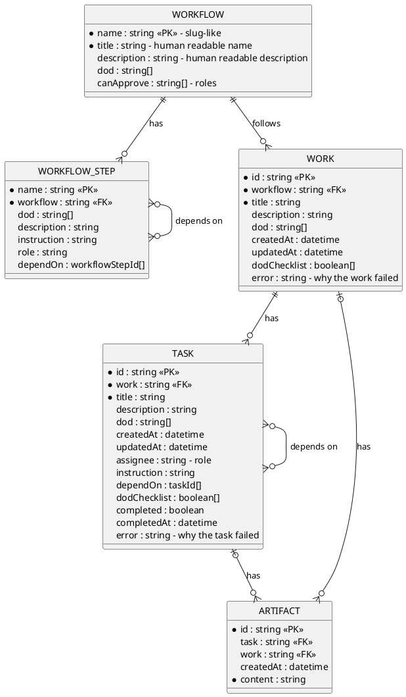

# Data contract

The agreement on where the data is kept, and on the entities that it holds. It
is not a container: the containers follow it when they read or write data, and
the runtime files are inside the container that owns them.

The data is file-based, under `{baseDir}/.superteam/`, where `baseDir` is the
root workspace, the place where the engine runs. The data has two kinds (see the
principles in `solution-strategy.md`), and each kind has one folder:

| Folder           | Kind        | In git |
| ---------------- | ----------- | ------ |
| `.superteam/.p/` | Persistence | Yes    |
| `.superteam/.r/` | Runtime     | No     |

An entity is one JSON file, and its path comes from its identity.

The persistence data is in `persistence-data.md`, and the runtime data is in
`runtime-data.md`.

## Data structure

A field whose name starts with `*` is required.

### Entity design

Entities are isolated: each one works on its own. An entity does not hold data
that is written back by an entity that refers to it, and the references between
entities never form a circle. So it is rare that more than one actor writes the
same entity.

### Roles

A role names a job. There are two kinds of role (see the principles in
`solution-strategy.md`):

- **The roles of the engine:** the assigner, the approver and the merger. The
  engine defines them.
- **The roles of the project:** such as the developer and the business analyst.
  The project defines them.

The fields `WORKFLOW_STEP.role`, `TASK.assignee` and `WORKFLOW.canApprove` hold
the names of roles. A job of a role can be done by a person or by an AI. So the
approver is a person or a bot.

### Derived status

These statuses are not stored. They are derived from the fields of the entities.

#### Task status

| Status        | Formula                                           |
| ------------- | ------------------------------------------------- |
| `PENDING`     | `depend_tasks_not_done.length > 0`                |
| `IN_PROGRESS` | `depend_tasks_not_done.length == 0 && !completed` |
| `DONE`        | `completed && !error`                             |
| `FAILED`      | `completed && error`                              |

`depend_tasks_not_done` is the tasks in `dependOn` that are not `DONE`. A task
that failed is `completed`, because its run has ended, and its `error` is the
reason. So a task that depends on a failed task stays `PENDING`.

#### Work status

| Status        | Formula                                                                                 |
| ------------- | --------------------------------------------------------------------------------------- |
| `OPEN`        | `!proposed && !error && tasks.length == 0`                                              |
| `IN_PROGRESS` | `!proposed && !error && tasks.length > completed_tasks.length`                          |
| `DONE`        | `proposed \|\| (tasks.length > 0 && tasks.length === completed_tasks.length && !error)` |
| `FAILED`      | `error`                                                                                 |

`completed_tasks` is the tasks that are `completed`, which includes the failed
ones. `error` is the `error` of the work, which the engine writes when a task
fails. `proposed` means that the work has a pull request, or that its file is in
`.superteam/.p/works/` on the root branch. The engine opens the pull request
only when all the tasks are done and none has failed, so a proposed work is
`DONE`, and it needs no task: the tasks are runtime data, and exist only in the
worktree of the work, which is removed after the pull request is opened. A
failed work needs no task either, because its `error` is in the file of the
work.

#### Work approval status

The approval status of a work is derived from its pull request only. The
decision of the approver is not stored: the merge of the pull request into the
root branch is the approval, and the git history keeps it.

| Approval status | Formula                                                    |
| --------------- | ---------------------------------------------------------- |
| `DRAFT`         | The work has no pull request                               |
| `PROPOSED`      | `pr.state == "open"`                                       |
| `APPROVED`      | `pr.state == "merged"`                                     |
| `REJECTED`      | `pr.state == "closed"`, which means closed without a merge |

`pr` is the pull request of the work, and `pr.state` is its state in git:
`open`, `merged`, or `closed` without a merge.

The engine opens the pull request only when all the tasks are done and none has
failed. So a work that has a pull request is `DONE`, and its status is not
derived from the tasks, which are runtime data and exist only in the worktree of
the work. A failed work is never proposed, so it has no pull request, and its
approval status stays `DRAFT`.

A work whose file is in `.superteam/.p/works/` on the root branch reached it
only by the merge of its pull request, so it is `DONE` and `APPROVED`.
