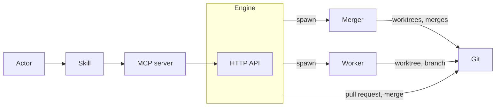

# Architecture

## Document levels

The documents are in four levels. Each level answers one question.

| Level           | Documents                                                                     | Question                                                                    | Does not hold                           |
| --------------- | ----------------------------------------------------------------------------- | --------------------------------------------------------------------------- | --------------------------------------- |
| 1. Architecture | `architecture.md`                                                             | What parts does the system have, what are the principles, who talks to whom | The detailed flows, event names, fields |
| 2. Component    | `engine.md`, `storage.md`, `data-struct.md`, `http-api.md`, `spawn-worker.md` | What does each part do, and what is its contract with the other parts       | The inside of a module                  |
| 3. Module       | `engineloop.md`, `eventloop.md`                                               | How does an independent module work inside                                  | How the other components use it         |
| 4. Plan         | `*_plan.md`                                                                   | In what order is it built                                                   | Design decisions                        |

Two rules:

- A level does not repeat the details of the level below it. It points to the
  document of that level.
- A level does not contradict the level above it.

## Principles

1. **Data has two kinds.**
   - **Persistence:** the data that must be kept in git. It is stored in
     `.superteam/.p`.
   - **Runtime:** the data that does not need to be kept in git. It is stored in
     `.superteam/.r`.
2. **The root branch does not create persistence data directly.** Persistence
   data is created as the result of merging a pull request.
3. **Persistence data has a purpose.** It is kept so that people can work across
   devices, synced through git, and so that the history of the work is kept. The
   unit of the history is the work.
4. **All the work is done in worktrees.** Each job is done in a git worktree,
   and its result is kept in a git branch.
5. **There are two kinds of job.**
   - **The jobs of the engine:** such as the merger and the approver.
   - **The jobs of the project:** the project defines them, such as the
     developer and the business analyst.
6. **A job can be done by a person or by an AI.** The two are interchangeable:
   one can take over from the other without interrupting the work.
7. **A worktree can read the runtime data of the root branch.**

## Layers

### Engine layer

#### Git

The platform that the engine builds on (see `engine.md`).

- A worktree is an environment of its own for each job.
- A remote branch keeps the results.
- A pull request is the way a work is approved.
- The merge of the pull request records the result.

#### Worktree

A worktree is the environment where a job is done (see the principles). It has a
branch of its own, where the result of the job is kept. There are two kinds, one
for each unit of the work: the worktree of a work and the worktree of a task.
The merger creates them, and their folders are runtime data, under
`.superteam/.r` (see `spawn-worker.md`).

#### Engine

The team lead: it takes a work, and gives back the output of the work. It owns
the workflow logic and the runtime state: the tasks, their progress, and the
workers. The results are kept in git.

- It has no UI and runs on its own, without the MCP server.
- It exposes an HTTP API, and its main clients are the AI sessions running on
  the same machine. The API works only at the level of the work (see
  `http-api.md`).
- The tasks, the workers and the worktrees are the business of the engine.
- An engine loop gives the events of the engine to the handlers, one at a time
  (see `engineloop.md`).
- There is only one engine instance, in the root workspace. A workspace is a
  working directory.
- The git worktrees created for workers have no engine.
- It keeps its runtime state in local files, in `.superteam/.r`, and these are
  not in git (see `storage.md`).

### Worker layer

#### Role

Defines a job by its capabilities and its responsibilities.

- It does the work that the engine coordinates.
- A job can be done by a person or by an AI, and the two are interchangeable.
- There are two kinds of role:
  - **The roles of the engine:** the merger and the approver.
  - **The roles of the project:** the project defines them, such as the
    developer, the designer and the business analyst. A role is concrete when it
    is put to use.

#### Worker process

A Claude process that runs one task: the way an AI does a task (see
`spawn-worker.md`).

- It is spawned and killed by the engine.
- It loads the requirements of the task, the context and the role, then runs the
  task.
- It works only in the worktree of its task, and its result is kept on the
  branch of the task. So a person can take over the task from the same worktree
  and branch, and the reverse.
- It returns its result to the engine as structured output. It does not go
  through the MCP server.
- It can read the runtime data of the root branch (see `storage.md`).

#### Merger

A role of the engine that does the git merges. Like any job, it is done in a
worktree, and the engine spawns it like a worker.

The merger is one level below the root, and it is responsible for the whole unit
of the work: the worktree of the work is its own, and the worktrees of the tasks
are below it. All the merges of the work are its job (see `spawn-worker.md`).

#### Approver

A role of the engine. The approver reviews a work in its pull request, and sends
the decision to the engine: the work is approved or rejected (see `engine.md`).
Like any job, it is done by a person or by a bot.

### Interface layer

An actor is whoever uses the system through this layer: a user or an AI agent.

#### MCP server

The interface through which actors call the engine.

- It is separate from the engine.
- It is only a client of the engine's HTTP API: it holds no logic or state of
  its own.
- It does not work normally when the engine is not running.

#### Skill

The bridge between a prompt and the API: it makes it easier for actors to
interact with the MCP server.

- It packages the steps of calling the MCP tools into one command for users, and
  guides agents to use the tools in the right order.
- It is a Claude skill, so it can be used in two ways: a user runs it as a slash
  command, or an agent loads it on its own when its meaning matches the task.
- It always goes through the MCP server. It never calls the engine directly.

## Usage flow

### Who talks to whom

### The life of a work

The life of a work, from assigned to its final result, is in "Life of a work" of
`data-struct.md`. The detailed flows are in "Sequence" of `engine.md`.
