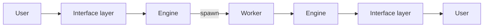

# Architecture

## Layers

### Engine layer

#### Storage

Where the state is kept.

- It belongs to the root workspace, where the engine runs.
- It is file-based.
- Only part of it is versioned with git. Runtime data is not.

#### Engine

Owns the workflow logic and all state: works, tasks, statuses, approval status,
artifacts and DOD checklists.

- It has no UI and runs on its own, without the MCP server.
- It exposes an HTTP API and listens on localhost only. It is not exposed
  outside the machine.
- Its main clients are the AI sessions running on the same machine.
- It follows CQRS: the read flow and the write flow are separate.
- Every write is an event (a write command) that goes through a single queue,
  including the writes from different AI sessions at the same time.
- The write flow is asynchronous: a write is accepted into the queue and the
  caller does not wait for it to be processed.
- The engine runs a loop that claims the events from the queue and processes
  them one at a time, in order, so there is no race condition.
- There is only one engine instance, in the root workspace. A workspace is a
  working directory.
- The git worktrees created for workers have no engine.
- It persists its state to local files (see Storage).

### Worker layer

#### Role

Defines an AI agent by its capabilities.

- It does the work that the engine coordinates.

#### Worker process

A Claude process that runs one task.

- It is spawned and killed by the engine.
- It loads the requirements of the task, the context and the role, then runs the
  task.
- It returns its result to the engine as structured output defined by a JSON
  schema. It does not go through the MCP server.

#### Merge agent

A special AI agent, not a worker process, that does the git merges (see "Spawn
worker").

- It is spawned by the engine in two cases, and in both it does a merge.
- When the engine prepares the worktree of a task: it merges the branches of the
  previous tasks into the new branch, before the worker runs.
- When the approval status of a work becomes `APPROVED`: it merges the branches
  of all the final tasks of the work into the root branch.

### Interface layer

#### MCP server

The interface through which agents call the engine.

- It is separate from the engine.
- It is only a client of the engine's HTTP API: it holds no logic or state of
  its own.
- It does not work normally when the engine is not running.

#### Skill

The bridge between a prompt and the API: it makes it easier for users and AI
agents to interact with the MCP server.

- It packages the steps of calling the MCP tools into one command for users, and
  guides agents to use the tools in the right order.
- It is a Claude skill, so it can be used in two ways: a user runs it as a slash
  command, or an agent loads it on its own when its meaning matches the task.
- It always goes through the MCP server. It never calls the engine directly.

## Usage flow

