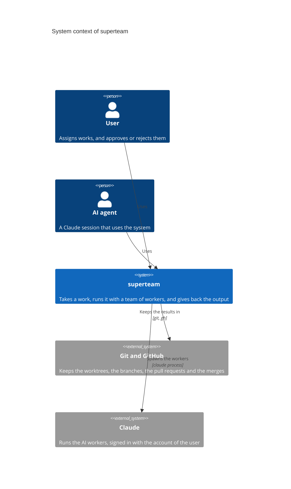
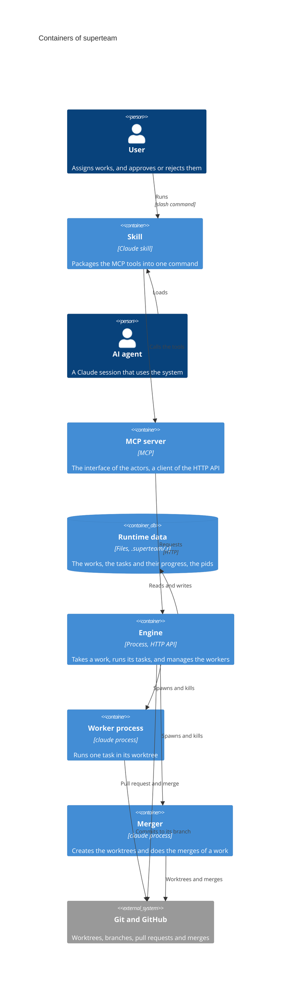

# Architecture

## Principles

1. **Data has two kinds.**
   - **Persistence:** the data that must be kept in git. It is stored in
     `.superteam/.p`.
   - **Runtime:** the data that does not need to be kept in git. It is stored in
     `.superteam/.r`.
2. **The root branch does not create persistence data directly.** Persistence
   data is created as the result of merging a pull request.
3. **Persistence data has a purpose.** It is kept so that people can work across
   devices, synced through git, and so that the history of the work is kept. The
   unit of the history is the work.
4. **All the work is done in worktrees.** Each job is done in a git worktree,
   and its result is kept in a git branch.
5. **There are two kinds of job.**
   - **The jobs of the engine:** such as the merger and the approver.
   - **The jobs of the project:** the project defines them, such as the
     developer and the business analyst.
6. **A job can be done by a person or by an AI.** The two are interchangeable:
   one can take over from the other without interrupting the work.
7. **A worktree can read the runtime data of the root branch.**

## Document levels

The documents follow the C4 model. Each level zooms into one part of the level
above it, and answers one question.

| Level        | Documents                                                                     | Question                                                                                 | Does not hold                   |
| ------------ | ----------------------------------------------------------------------------- | ---------------------------------------------------------------------------------------- | ------------------------------- |
| 1. Context   | `architecture.md`                                                             | Who uses the system, and what outside the system does it depend on                       | The parts inside the system     |
| 2. Container | `architecture.md`                                                             | What runs or keeps data (a process, a store), what are the principles, who talks to whom | The inside of a container       |
| 3. Component | `engine.md`, `storage.md`, `data-struct.md`, `http-api.md`, `spawn-worker.md` | What are the parts inside one container, and what is the contract between them           | The inside of a module          |
| 4. Code      | `engineloop.md`, `eventloop.md`                                               | How does an independent module work inside                                               | How the other components use it |

Two rules:

- A level does not repeat the details of the level below it. It points to the
  document of that level.
- A level does not contradict the level above it.

## Context

The system is `superteam`. It takes a work and gives back the output of the
work, with a team of workers. An actor is a user or an AI agent.

## Container

A container is something that runs or keeps data. The containers of `superteam`
are below.

## Component

Each container is broken down into components below. The inside of a component
is in its own document.

| Container      | Component      | Job                                                                                                                                                                     | Document                       |
| -------------- | -------------- | ----------------------------------------------------------------------------------------------------------------------------------------------------------------------- | ------------------------------ |
| Skill          | Skill          | The bridge between a prompt and the MCP tools. A user runs it as a slash command, or an agent loads it. It always goes through the MCP server.                          | None yet                       |
| MCP server     | MCP server     | The interface through which actors call the engine. It is only a client of the HTTP API: no logic or state of its own. It does not work when the engine is not running. | None yet                       |
| Engine         | HTTP API       | The only door to the engine, at the level of the work.                                                                                                                  | `http-api.md`                  |
| Engine         | Engine loop    | Gives the events of the engine to the handlers, one at a time.                                                                                                          | `engineloop.md`                |
| Engine         | Handlers       | Do the next step of a work, one for each type of event.                                                                                                                 | `engine.md`                    |
| Engine         | Worker manager | Spawns, watches and kills the worker processes and the merger.                                                                                                          | `spawn-worker.md`              |
| Worker process | Worker process | Runs one task in its worktree. It returns its result to the engine, not through the MCP server.                                                                         | `spawn-worker.md`              |
| Merger         | Merger         | Creates the worktrees of a work and does all its merges.                                                                                                                | `spawn-worker.md`              |
| Runtime data   | Runtime data   | The files of the engine under `.superteam/.r`: the works, the tasks and their progress, the pids.                                                                       | `storage.md`, `data-struct.md` |

- The engine has no UI and runs on its own, without the MCP server.
