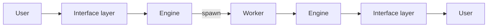
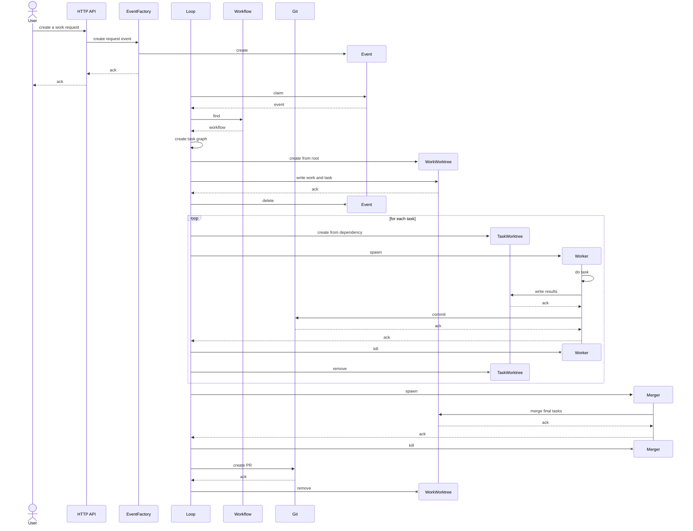
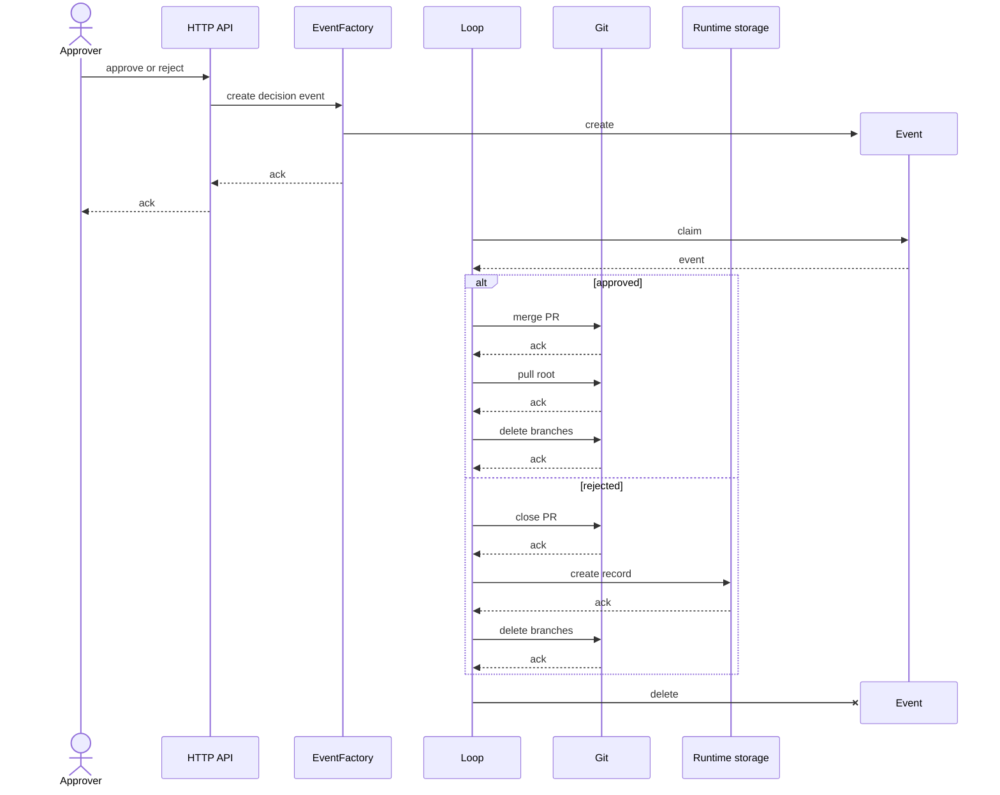

# Architecture

## Principles

1. **Data has two kinds.**
   - **Persistence:** the data that must be kept in git. It is stored in
     `.superteam/.p`.
   - **Runtime:** the data that does not need to be kept in git. It is stored in
     `.superteam/.r`.
2. **The root branch does not create persistence data directly.** Persistence
   data is created as the result of merging a pull request.
3. **Persistence data has a purpose.** It is kept so that people can work across
   devices, synced through git, and so that the history of the work is kept. The
   unit of the history is the work.
4. **All the work is done in worktrees.** Each job is done in a git worktree,
   and its result is kept in a git branch.
5. **There are two kinds of job.**
   - **The jobs of the engine:** such as the merger and the approver.
   - **The jobs of the project:** the project defines them, such as the
     developer and the business analyst.
6. **A job can be done by a person or by an AI.** The two are interchangeable:
   one can take over from the other without interrupting the work.

## Layers

### Engine layer

#### Git

The platform that the engine builds on (see `engine.md`).

- A worktree is an environment of its own for each worker.
- A remote branch keeps the results.
- A pull request is the way a work is approved.
- The merge of the pull request records the result.
- The engine reaches git and the forge through a git adapter, so that another
  forge can be added later. For now only GitHub is supported, and it needs the
  `gh` command line.

#### Engine

The team lead: it takes a work, and gives back the output of the work. It owns
the workflow logic and the runtime state: the tasks, their progress, and the
workers. The results are kept in git.

- It has no UI and runs on its own, without the MCP server.
- It exposes an HTTP API and listens on localhost only. It is not exposed
  outside the machine.
- The API works only at the level of the work. The tasks, the workers and the
  worktrees are the business of the engine.
- Its main clients are the AI sessions running on the same machine.
- An orchestrator moves each work to its next step, and it can do a step again
  without doing it twice.
- There is only one engine instance, in the root workspace. A workspace is a
  working directory.
- The git worktrees created for workers have no engine.
- It keeps its runtime state in local files, and these are not in git.

### Worker layer

#### Role

Defines an AI agent by its capabilities.

- It does the work that the engine coordinates.
- A worker role is concrete when it is put to use: a developer, a designer, a
  business analyst.

#### Worker process

A Claude process that runs one task.

- It is spawned and killed by the engine.
- It loads the requirements of the task, the context and the role, then runs the
  task.
- It returns its result to the engine as structured output defined by a JSON
  schema. It does not go through the MCP server.
- What code can do is not left to the worker. The architecture has two ways to
  give it that help, and keeps both open:
  - A standalone script that the worker runs, such as the creation of an
    artifact. It needs no engine: it works on the files and on git in the
    worktree.
  - A stateless API of the engine, which only computes for the worker. It keeps
    no state, and the worker calls it over HTTP. There is no use case for it
    yet.

#### Merge agent

A role that does the git merges (see "Spawn worker"). It is spawned in a
worktree by the engine, like a worker, and it is only not made abstract like the
worker role.

- It is spawned by the engine in two cases, and in both it does a merge.
- When the engine prepares the worktree of a task that depends on more than one
  task: it merges the branches of the other dependencies into the new branch,
  before the worker runs.
- When the work is `PROPOSED`: it merges the branches of all the final tasks of
  the work into one branch of the work. The engine, not the merge agent, then
  pushes this branch and opens the pull request.

### Interface layer

#### MCP server

The interface through which agents call the engine.

- It is separate from the engine.
- It is only a client of the engine's HTTP API: it holds no logic or state of
  its own.
- It does not work normally when the engine is not running.

#### Skill

The bridge between a prompt and the API: it makes it easier for users and AI
agents to interact with the MCP server.

- It packages the steps of calling the MCP tools into one command for users, and
  guides agents to use the tools in the right order.
- It is a Claude skill, so it can be used in two ways: a user runs it as a slash
  command, or an agent loads it on its own when its meaning matches the task.
- It always goes through the MCP server. It never calls the engine directly.

## Usage flow

## Sequence

### Create and run a work

### Approve or reject a work

