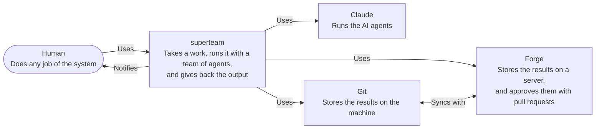
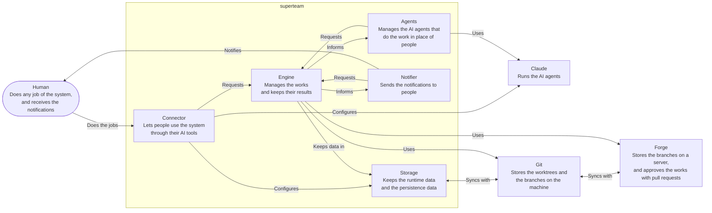

# Architecture

## Principles

0. **Use as much code as possible for the jobs that are determined.** A job
   whose steps and result are known in advance is done by code, not by an AI.
1. **Data has two kinds.**
   - **Persistence:** the data that must be kept in git. It is stored in
     `.superteam/.p`.
   - **Runtime:** the data that does not need to be kept in git. It is stored in
     `.superteam/.r`.
2. **The engine does not create persistence data directly.** It changes
   persistence data indirectly, by merging a pull request in the approve
   activity.
3. **Persistence data has a purpose.** It is kept so that people can work across
   devices, synced through git, and so that the history of the work is kept. The
   unit of the history is the work.
4. **There are two kinds of job.**
   - **The jobs of the engine:** the jobs that the engine itself understands, so
     the engine defines their interface. They are the assigner, the approver and
     the merger.
   - **The jobs of the project:** the engine knows them only in general, as the
     worker role. The project defines them in detail, such as the developer and
     the business analyst.
5. **Worktrees are used only by the worker and the merger.** Each of them does
   its job in a git worktree, and its result is kept in a git branch.
6. **A job can be done by a person or by an AI.** The two are interchangeable:
   one can take over from the other without interrupting the work.
7. **A worktree can read the runtime data of the root branch.**

## Document levels

The documents follow the C4 model. Each level zooms into one part of the level
above it, and answers one question.

| Level                 | Documents                            | Question                                                                                                  | Does not hold                      |
| --------------------- | ------------------------------------ | --------------------------------------------------------------------------------------------------------- | ---------------------------------- |
| 1. Context            | `architecture.md`                    | Who uses the system, and what outside the system does it depend on                                        | The parts inside the system        |
| 2. Container          | `architecture.md`                    | What runs or keeps data (a process, a store), what are the principles, who talks to whom                  | The inside of a container          |
| 3. Component, 4. Code | See the tree in "Component and Code" | What are the parts inside one container, what is the contract between them, and how does each work inside | The inside of the other components |

Two rules:

- A level does not repeat the details of the level below it. It points to the
  document of that level.
- A level does not contradict the level above it.

## Context

The system is `superteam`. It takes a work and gives back the output of the
work, with a team of agents. An actor is a human.



## Container

`superteam` is made of five parts:

- **Engine:** manages the works and the worktrees. It keeps its data in the
  Storage, and uses Git and the forge. It talks with the other parts through an
  HTTP API and pub/sub.
- **Connector:** lets people use the system through their AI tools.
- **Agents:** manages the AI agents that do the work in place of people. It
  talks with the engine through the HTTP API and pub/sub.
- **Notifier:** sends the notifications to people. It talks with the engine
  through the HTTP API and pub/sub.
- **Storage:** keeps the data of the system: the runtime data and the
  persistence data.



## Component and Code

Each container has one document, and each of its components has one document.
Each document holds both levels:

- Component: its contract with the other components.
- Code: how it works inside.

```
docs/
├── architecture.md          The context, the containers and the principles
├── engine/
│   ├── engine.md            Manages the works and the worktrees
│   ├── http-api.md          The only door to the engine, at the level of the work
│   ├── pubsub.md            How the engine informs the other parts about its events
│   ├── engineloop.md        Gives the events of the engine to the handlers, one at a time
│   ├── handlers.md          Do the next step of a work, one for each type of event
│   └── git-adapter.md       How the engine reaches git and the forge, through `gh` for now
├── connector/
│   ├── connector.md         Lets people use the system through their AI tools
│   ├── seed-skill.md        Only creates the config files: the workflows and the roles of Claude
│   ├── operation-skill.md   The bridge between a prompt and the MCP tools
│   └── mcp-server.md        An interface through which actors call the engine
├── agents/
│   ├── agents.md            Manages the AI agents that do the work in place of people
│   ├── agent-manager.md     Spawns, watches and kills the `claude` processes
│   └── claude-process.md    The `claude` processes that run the AI agents
├── notifier/
│   ├── notifier.md          Sends the notifications to people
│   └── google-chat.md       Sends the notifications through Google Chat
└── storage/
    ├── storage.md           Keeps the runtime data and the persistence data
    ├── runtime-data.md      The files under `.superteam/.r`
    └── persistence-data.md  The files under `.superteam/.p`, kept in git
```
