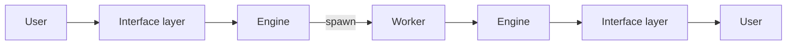
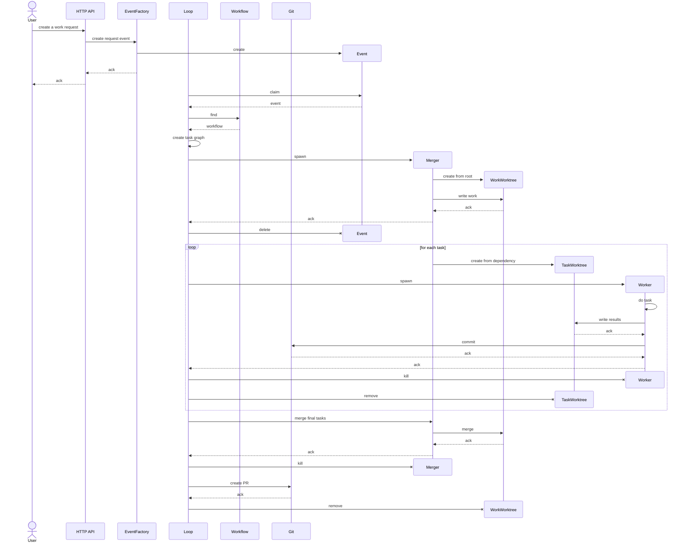
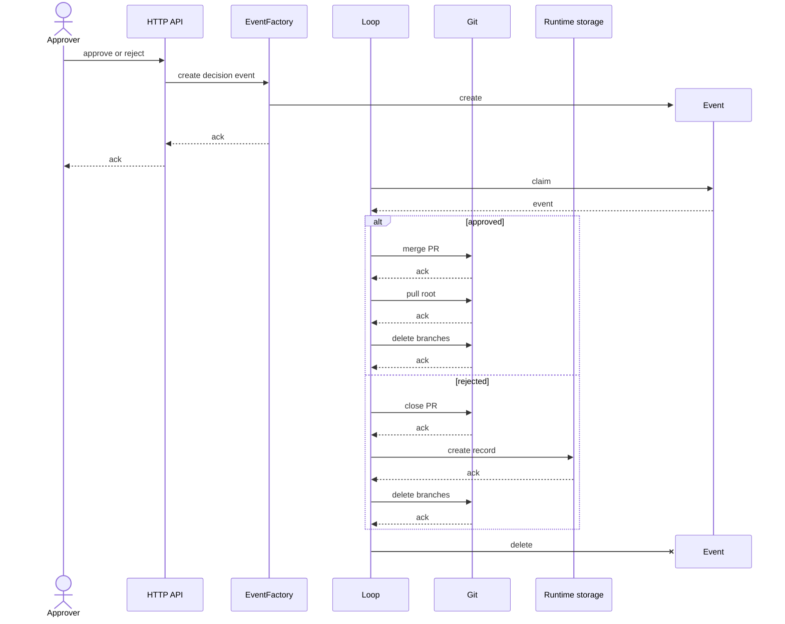

# Architecture

## Principles

1. **Data has two kinds.**
   - **Persistence:** the data that must be kept in git. It is stored in
     `.superteam/.p`.
   - **Runtime:** the data that does not need to be kept in git. It is stored in
     `.superteam/.r`.
2. **The root branch does not create persistence data directly.** Persistence
   data is created as the result of merging a pull request.
3. **Persistence data has a purpose.** It is kept so that people can work across
   devices, synced through git, and so that the history of the work is kept. The
   unit of the history is the work.
4. **All the work is done in worktrees.** Each job is done in a git worktree,
   and its result is kept in a git branch.
5. **There are two kinds of job.**
   - **The jobs of the engine:** such as the merger and the approver.
   - **The jobs of the project:** the project defines them, such as the
     developer and the business analyst.
6. **A job can be done by a person or by an AI.** The two are interchangeable:
   one can take over from the other without interrupting the work.
7. **A worktree can read the runtime data of the root branch.**

## Layers

### Engine layer

#### Git

The platform that the engine builds on (see `engine.md`).

- A worktree is an environment of its own for each job.
- A remote branch keeps the results.
- A pull request is the way a work is approved.
- The merge of the pull request records the result.
- The engine reaches git and the forge through a git adapter, so that another
  forge can be added later. For now only GitHub is supported, and it needs the
  `gh` command line.

#### Worktree

A worktree is the environment where a job is done (see the principles). It has a
branch of its own, where the result of the job is kept. There are two kinds of
worktree, one for each unit of the work: the work and the task.

|                    | Worktree of a work                                                                                                                                                                    | Worktree of a task                                                                                                                                                                           |
| ------------------ | ------------------------------------------------------------------------------------------------------------------------------------------------------------------------------------- | -------------------------------------------------------------------------------------------------------------------------------------------------------------------------------------------- |
| Unit               | One for each work.                                                                                                                                                                    | One for each task.                                                                                                                                                                           |
| Based on           | The root branch.                                                                                                                                                                      | The branch of the task it depends on. A task with no dependency is based on the root branch. A task with more than one dependency is based on one of them, and the merger merges the others. |
| Branch             | `works/{work_id}`                                                                                                                                                                     | `tasks/{work_id}/{task_id}`                                                                                                                                                                  |
| Folder             | `.superteam/.r/worktrees/works/{work_id}`                                                                                                                                             | `.superteam/.r/worktrees/tasks/{work_id}/{task_id}`                                                                                                                                          |
| Created            | When the work is assigned.                                                                                                                                                            | When the task starts.                                                                                                                                                                        |
| Created by         | The merger.                                                                                                                                                                           | The merger.                                                                                                                                                                                  |
| Managed by         | The merger. All the merges are done by this role: the merge of the tasks, and the last merge.                                                                                         | The merger creates it, and the job of the task is done in it.                                                                                                                                |
| What is done in it | The merger writes the work, from its runtime record, and commits it on the branch. It merges the branches of the final tasks. The engine then pushes the branch for the pull request. | The job of the task, by a worker, a person or an AI.                                                                                                                                         |
| Removed            | After the pull request is opened.                                                                                                                                                     | When the task ends.                                                                                                                                                                          |

The folders of the worktrees are runtime data, so they are under
`.superteam/.r`. The folder of a task is not inside the folder of its work: a
folder inside a worktree would show up there as an untracked file.

The branch of a worktree is kept after the worktree is removed, because it is
merged later. All the branches of a work, its own and the branches of its tasks,
are deleted when the work ends.

#### Engine

The team lead: it takes a work, and gives back the output of the work. It owns
the workflow logic and the runtime state: the tasks, their progress, and the
workers. The results are kept in git.

- It has no UI and runs on its own, without the MCP server.
- It exposes an HTTP API and listens on localhost only. It is not exposed
  outside the machine.
- The API works only at the level of the work. The tasks, the workers and the
  worktrees are the business of the engine.
- Its main clients are the AI sessions running on the same machine.
- An engine loop gives the events of the engine to the handlers, one at a time,
  and a handler can be done again without doing a step twice (see
  `engineloop.md`).
- There is only one engine instance, in the root workspace. A workspace is a
  working directory.
- The git worktrees created for workers have no engine.
- It keeps its runtime state in local files, in `.superteam/.r`, and these are
  not in git.

### Worker layer

#### Role

Defines a job by its capabilities and its responsibilities.

- It does the work that the engine coordinates.
- A job can be done by a person or by an AI, and the two are interchangeable.
- There are two kinds of role:
  - **The roles of the engine:** the merger and the approver.
  - **The roles of the project:** the project defines them, such as the
    developer, the designer and the business analyst. A role is concrete when it
    is put to use.

#### Worker process

A Claude process that runs one task: the way an AI does a task.

- It is spawned and killed by the engine.
- It loads the requirements of the task, the context and the role, then runs the
  task.
- It works only in the worktree of its task, and its result is kept on the
  branch of the task. So a person can take over the task from the same worktree
  and branch, and the reverse.
- It returns its result to the engine as structured output defined by a JSON
  schema. It does not go through the MCP server.
- It can read the runtime data of the root branch in two ways, and the
  architecture keeps both open: it reads the path in the root workspace
  directly, or it calls a read API of the engine, which reads in the root.
- What code can do is not left to the worker. The architecture has two ways to
  give it that help, and keeps both open:
  - A standalone script that the worker runs, such as the creation of an
    artifact. It needs no engine: it works on the files and on git in the
    worktree.
  - A stateless API of the engine, which only computes for the worker. It keeps
    no state, and the worker calls it over HTTP. There is no use case for it
    yet.

#### Merge agent

The merger: a role of the engine that does the git merges (see "Spawn worker").
Like any job, it is done in a worktree, and the engine spawns it like a worker.

The merger is one level below the root, and it is responsible for the whole unit
of the work: the worktree of the work is its own, and the worktrees of the tasks
are below it.

- It creates the worktree of each task, based on the branch of the task it
  depends on. When the task depends on more than one task, it merges the
  branches of the other dependencies into the new branch, before the worker
  runs.
- It creates the worktree of the work, based on the root branch, and manages it.
  All the merges of the work are its job: the merge of the tasks, and the last
  merge. When the work is `PROPOSED`, it merges the branches of all the final
  tasks of the work into the branch of the work.
- The engine, not the merger, then pushes the branch of the work and opens the
  pull request.

#### Approver

A role of the engine. The approver reviews a work in its pull request, and sends
the decision to the engine: the work is approved or rejected (see `engine.md`).

### Interface layer

#### MCP server

The interface through which agents call the engine.

- It is separate from the engine.
- It is only a client of the engine's HTTP API: it holds no logic or state of
  its own.
- It does not work normally when the engine is not running.

#### Skill

The bridge between a prompt and the API: it makes it easier for users and AI
agents to interact with the MCP server.

- It packages the steps of calling the MCP tools into one command for users, and
  guides agents to use the tools in the right order.
- It is a Claude skill, so it can be used in two ways: a user runs it as a slash
  command, or an agent loads it on its own when its meaning matches the task.
- It always goes through the MCP server. It never calls the engine directly.

## Usage flow

## Sequence

### Create and run a work

### Approve or reject a work

