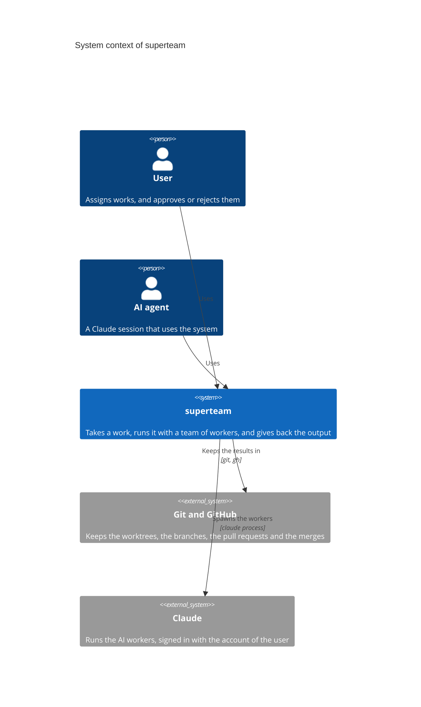
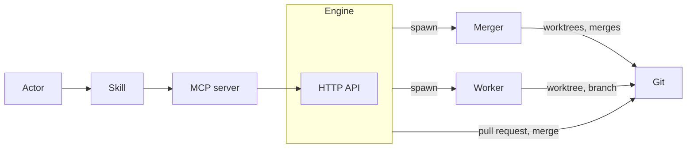

# Architecture

## Document levels

The documents follow the C4 model. Each level zooms into one part of the level
above it, and answers one question.

| Level        | Documents                                                                     | Question                                                                                 | Does not hold                   |
| ------------ | ----------------------------------------------------------------------------- | ---------------------------------------------------------------------------------------- | ------------------------------- |
| 1. Context   | `architecture.md`                                                             | Who uses the system, and what outside the system does it depend on                       | The parts inside the system     |
| 2. Container | `architecture.md`                                                             | What runs or keeps data (a process, a store), what are the principles, who talks to whom | The inside of a container       |
| 3. Component | `engine.md`, `storage.md`, `data-struct.md`, `http-api.md`, `spawn-worker.md` | What are the parts inside one container, and what is the contract between them           | The inside of a module          |
| 4. Code      | `engineloop.md`, `eventloop.md`                                               | How does an independent module work inside                                               | How the other components use it |

Two rules:

- A level does not repeat the details of the level below it. It points to the
  document of that level.
- A level does not contradict the level above it.

## Context

The system is `superteam`. It takes a work and gives back the output of the
work, with a team of workers. An actor is a user or an AI agent.

## Principles

1. **Data has two kinds.**
   - **Persistence:** the data that must be kept in git. It is stored in
     `.superteam/.p`.
   - **Runtime:** the data that does not need to be kept in git. It is stored in
     `.superteam/.r`.
2. **The root branch does not create persistence data directly.** Persistence
   data is created as the result of merging a pull request.
3. **Persistence data has a purpose.** It is kept so that people can work across
   devices, synced through git, and so that the history of the work is kept. The
   unit of the history is the work.
4. **All the work is done in worktrees.** Each job is done in a git worktree,
   and its result is kept in a git branch.
5. **There are two kinds of job.**
   - **The jobs of the engine:** such as the merger and the approver.
   - **The jobs of the project:** the project defines them, such as the
     developer and the business analyst.
6. **A job can be done by a person or by an AI.** The two are interchangeable:
   one can take over from the other without interrupting the work.
7. **A worktree can read the runtime data of the root branch.**

## Layers

### Engine layer

#### Git

The platform that the engine builds on. It holds the worktrees, the branches,
the pull requests and the merges (see `engine.md`).

#### Worktree

The environment where a job is done, with a branch of its own for the result
(see `spawn-worker.md`).

#### Engine

The team lead: it takes a work, and gives back the output of the work. It owns
the workflow logic and the runtime state, and it exposes an HTTP API to its
clients (see `engine.md`, `http-api.md`, `engineloop.md`, `storage.md`).

- It has no UI and runs on its own, without the MCP server.

### Worker layer

#### Role

Defines a job by its capabilities and its responsibilities. There are roles of
the engine and roles of the project (see the principles).

#### Worker process

A Claude process that runs one task: the way an AI does a task. It is spawned
and killed by the engine, and it returns its result to the engine, not through
the MCP server (see `spawn-worker.md`).

#### Merger

A role of the engine that does the git merges of a work (see `spawn-worker.md`).

#### Approver

A role of the engine that reviews a work in its pull request and decides whether
it is approved or rejected (see `engine.md`).

### Interface layer

An actor is whoever uses the system through this layer: a user or an AI agent.

#### MCP server

The interface through which actors call the engine.

- It is separate from the engine.
- It is only a client of the engine's HTTP API: it holds no logic or state of
  its own (see `http-api.md`).
- It does not work normally when the engine is not running.

#### Skill

The bridge between a prompt and the API: it makes it easier for actors to
interact with the MCP server. A user runs it as a slash command, or an agent
loads it on its own. It always goes through the MCP server, and never calls the
engine directly.

## Usage flow

### Who talks to whom

