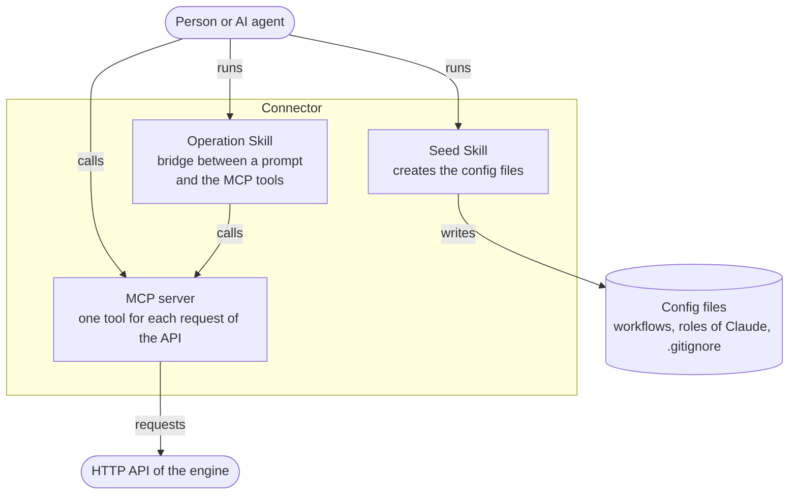

# Connector

Lets people use the system through their AI tools. It is a set of tools, and it
has no flow of its own.

## Component

- `seed-skill.md`: creates the config files of a project.
- `operation-skill.md`: the bridge between a prompt and the MCP tools.
- `mcp-server.md`: an interface through which actors call the engine.

