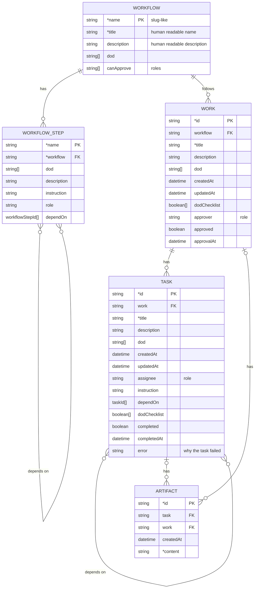

# Data structure

A field whose name starts with `*` is required.

## Entity design

Entities are isolated: each one works on its own. An entity does not hold data
that is written back by an entity that refers to it, and the references between
entities never form a circle. So it is rare that more than one actor writes the
same entity.

## Derived status

These statuses are not stored. They are derived from the fields of the entities.

### Task status

| Status        | Formula                                           |
| ------------- | ------------------------------------------------- |
| `PENDING`     | `depend_tasks_not_done.length > 0`                |
| `IN_PROGRESS` | `depend_tasks_not_done.length == 0 && !completed` |
| `DONE`        | `completed && !error`                             |
| `FAILED`      | `completed && error`                              |

`depend_tasks_not_done` is the tasks in `dependOn` that are not `DONE`. A task
that failed is `completed`, because its run has ended, and its `error` is the
reason. So a task that depends on a failed task stays `PENDING`.

### Work status

| Status        | Formula                                                                                   |
| ------------- | ----------------------------------------------------------------------------------------- |
| `OPEN`        | `tasks.length == 0`                                                                       |
| `IN_PROGRESS` | `tasks.length > 0 && tasks.length > completed_tasks.length && failed_tasks.length == 0`   |
| `DONE`        | `tasks.length > 0 && tasks.length === completed_tasks.length && failed_tasks.length == 0` |
| `FAILED`      | `failed_tasks.length > 0`                                                                 |

`failed_tasks` is the tasks that are `FAILED`.

### Work approval status

The approval status of a work is derived from the fields of the work and its
tasks. A failed work is never proposed, so its approval status stays `DRAFT`.

| Approval status | Formula                                                                                                              |
| --------------- | -------------------------------------------------------------------------------------------------------------------- |
| `DRAFT`         | `tasks.length === 0 \|\| tasks.length > completed_tasks.length \|\| failed_tasks.length > 0`                         |
| `PROPOSED`      | `tasks.length > 0 && tasks.length === completed_tasks.length && failed_tasks.length == 0 && !approvalAt`             |
| `APPROVED`      | `tasks.length > 0 && tasks.length === completed_tasks.length && failed_tasks.length == 0 && approvalAt && approved`  |
| `REJECTED`      | `tasks.length > 0 && tasks.length === completed_tasks.length && failed_tasks.length == 0 && approvalAt && !approved` |
