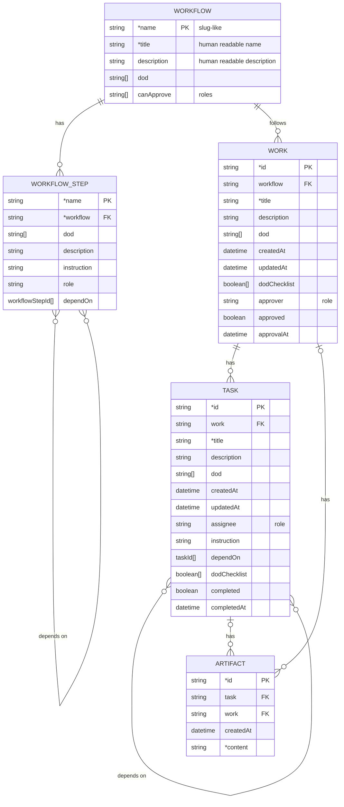

# Data structure

A field whose name starts with `*` is required.

## Derived status

These statuses are not stored. They are derived from the fields of the entities.

### Task status

| Status        | Formula                                                |
| ------------- | ------------------------------------------------------ |
| `PENDING`     | `depend_tasks_not_completed.length > 0`                |
| `IN_PROGRESS` | `depend_tasks_not_completed.length == 0 && !completed` |
| `DONE`        | `completed`                                            |

`depend_tasks_not_completed` is the tasks in `dependOn` that are not completed.

### Work status

| Status        | Formula                                                       |
| ------------- | ------------------------------------------------------------- |
| `OPEN`        | `tasks.length == 0`                                           |
| `IN_PROGRESS` | `tasks.length > 0 && tasks.length > completed_tasks.length`   |
| `DONE`        | `tasks.length > 0 && tasks.length === completed_tasks.length` |

### Work approval status

The approval status of a work is derived from the fields of the work and its
tasks.

| Approval status | Formula                                                                                  |
| --------------- | ---------------------------------------------------------------------------------------- |
| `DRAFT`         | `tasks.length === 0 \|\| tasks.length > completed_tasks.length`                          |
| `PROPOSED`      | `tasks.length > 0 && tasks.length === completed_tasks.length && !approvalAt`             |
| `APPROVED`      | `tasks.length > 0 && tasks.length === completed_tasks.length && approvalAt && approved`  |
| `REJECTED`      | `tasks.length > 0 && tasks.length === completed_tasks.length && approvalAt && !approved` |
