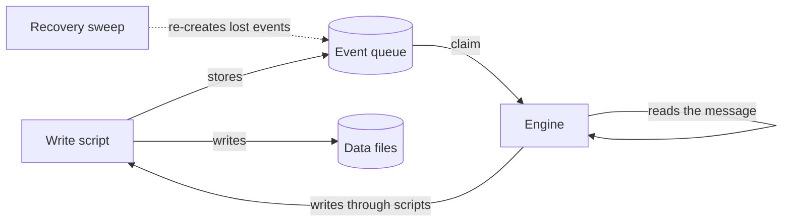
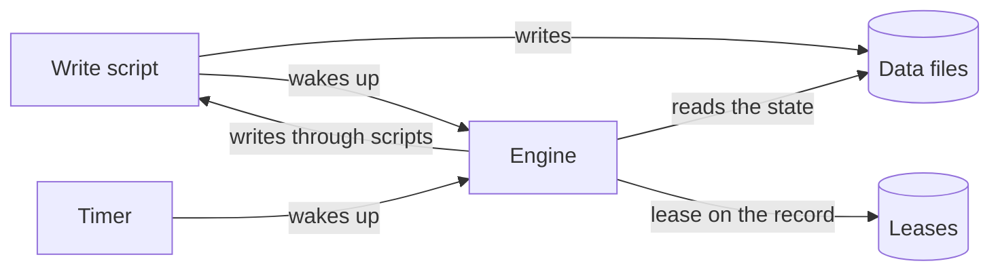
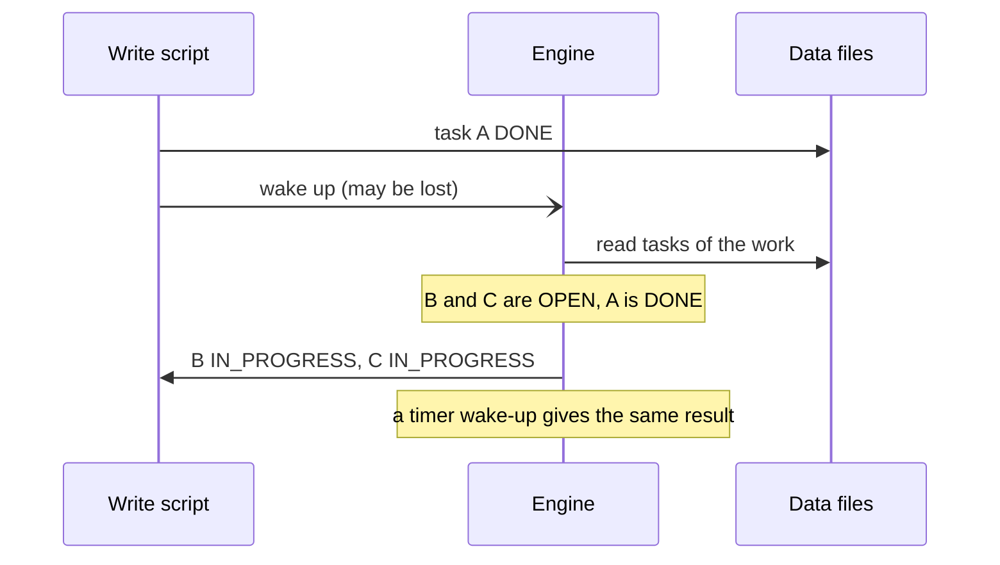

# Event-driven and reconcile

Draft. A comparison of two ways to drive the engine, written to decide before the queue (QUEUE.md) is built. It uses the flows of the README: the work flow (1.5), the approval flow (1.6) and the addons (1.7).

## The question

The engine reacts to changes of the data files. The question is what it takes as the truth about work to do:

- **Event-driven (the current design):** the truth is the event. A write stores a message, the engine consumes it and does what the message says.
- **Reconcile:** the truth is the data files. A write only wakes the engine up. The engine reads the state, computes what is missing, and does it.

## Where the current design grows

Two stores hold the truth, the data files and the events, and most of the machinery keeps them in agreement. Each fix creates a new case to fix:

| Problem | Mechanism |
|---|---|
| The file and the event are not written atomically | Outbox, hashes, temp path, wait up to 10 s (or `prepare` and `commit`, option A of QUEUE.md) |
| An event can be lost | Recovery sweep of the leader, `recoveries`, at most once |
| A process dies midway | `claims/{pid}`, a manual command, or a lease with `renew` |
| Recovery and a claim can meet | `hasPending`, read the queue before the claims |
| A chain of events can loop | `depth` and a depth limit |

## The two models

### Event-driven

The engine does what the message says. The recovery sweep is a second path that exists for the cases where the first one failed.

### Reconcile

The engine runs one loop: read the state, find what is missing, do it. A wake-up from a write and a wake-up from the timer are the same thing. There is no second path for recovery.

## The flows as rules on the state

The rules of 1.5 and 1.6 already read as conditions on the data. Written that way, each is a function of the current state:

| Rule | Condition on the data | Action |
|---|---|---|
| Create the tasks | A work has a `type`, and has no tasks | Create one task per step, `OPEN` |
| Start a task | A task is `OPEN` and every task in its `dependOn` is `DONE` | Set it `IN_PROGRESS` |
| Do a task (bot) | A task is `IN_PROGRESS`, its assignee is a bot role, and nobody holds its lease | Call the brain |
| Finish a work | Every task of a work is `DONE`, and the work is not `DONE` | Set the work `DONE` |
| Approve (bot) | A work is `DONE`, it is given to a bot role, it has no decision, and nobody holds its lease | Call the brain |

In the event-driven model the same rules run as "on `_task:update` to `DONE`, do this". The conditions are the same: only the trigger of the evaluation differs.

## Scenarios

### 1. A task ends and the next one must start

Tasks B and C both depend on A, and A ends.

**Event-driven.** `_task:update` of A (`DONE`) is a message. The engine claims it, finds B and C, and writes `IN_PROGRESS` on both. If that message is lost, B and C stay `OPEN` and nothing notices: the recovery of the leader looks only for tasks that are `IN_PROGRESS` with a bot assignee, and for works that are `DONE` without a decision. This is the case that makes option B of QUEUE.md unsafe.

**Reconcile.** The wake-up reads the state: B and C are `OPEN` and A is `DONE`, so they start. If the wake-up is lost, the timer reads the same state and does the same thing.

### 2. Two tasks end at the same time

Tasks B and C run in parallel and end together. Both engine processes see "every task is `DONE`".

**Event-driven.** Two messages, two processes. Both set the work `DONE`, so the approval may start twice. The code must guard against it.

**Reconcile.** The work has one lease. The process that holds it sets the work `DONE`. The other finds the lease taken, or finds the work already `DONE`, and does nothing. The condition "the work is not `DONE`" makes the action safe to repeat.

### 3. The brain or the agent dies

**Event-driven.** The claim stays in `claims/{pid}` (or the lease expires). A retry must not start a second agent while the first is alive, hence `X-Agent-Pid`. Recovery then touches the record at most once.

**Reconcile.** A task is `IN_PROGRESS` and its lease has expired: the condition "nobody holds its lease" is true, so the engine calls the brain again. The lease is renewed while the agent is alive, so a job of hours keeps it. The limit on attempts is a counter on the record, not a special case of recovery.

### 4. A write script dies in the middle

**Event-driven.** The data file and the event can disagree, which is why the outbox has hashes, a temp path and a wait, or why `prepare` and `commit` exist.

**Reconcile.** There is no event to disagree with. Either the file is in place, and the state is read as it is, or it is not, and nothing happened. The temp file is the only thing to clean up.

### 5. An addon posts when a task has just started

**Event-driven.** The event carries `changes` with the old and the new value. The addon sees `status` go from `OPEN` to `IN_PROGRESS` and posts. Each event is delivered once, and a failed delivery is not retried.

**Reconcile.** There is no old value. The engine needs a marker per record in the runtime store: the last status it delivered to the addons. When the status differs from the marker, the engine delivers and updates the marker. It is the one place where reconcile needs to remember something. A crash between the delivery and the marker gives a duplicate, so an addon must tolerate one.

### 6. A loop

The brain's answer writes a task, and that write wakes the engine up again.

**Event-driven.** Every message carries a `depth`, one more than the message that caused it, and the engine stops at a limit.

**Reconcile.** There is no chain to count. A rule that does nothing when the state is already right ends the loop by itself. For the brain, a counter of attempts on the record stops a task that always fails, like `recoveries` today.

## Comparison

| | Event-driven | Reconcile |
|---|---|---|
| Source of truth | Data files and events | Data files |
| Queue | Messages with content | Leases by record key, and a wake-up |
| Write and event consistency | Outbox, hashes, or `prepare` and `commit` | Not needed |
| A lost wake-up or message | Can leave work stuck, repaired only for some cases | Repaired by the next wake-up, for every case |
| Recovery | A second path, with its own rules | The normal path |
| Process dies | `claims/{pid}` or a lease, a manual command | A lease expires |
| Parallel and repeated work | Guards in code | The condition and the lease make it safe |
| Loop protection | `depth` | Idempotent rules, attempts on the record |
| Knowing what just changed | `changes` of the event | A marker per record, kept at runtime |
| Addon delivery | Once, no retry | At least once, so an addon tolerates a duplicate |
| Order of work | The id of the queue | None guaranteed. The rules do not depend on an order |
| Cost of a wake-up | Reads one message | Reads the state. Scoped by the key of the record that changed, plus a full pass on the timer |
| Reading the history of what happened | Messages, until they are removed | Git and the data files |

## What reconcile asks for

1. **Idempotent rules.** Every rule must be safe to run twice on the same state. The conditions above are written for it.
2. **A runtime store with two small things:** the leases by record key, and the marker of what was delivered to the addons. It is not in git and can be deleted.
3. **A scope for the read.** A wake-up carries the key of the record that changed, so the engine reads that record and the ones around it (the tasks of the work), not everything. A full pass runs on a timer.
4. **A decision for the addons:** the first delivery may be repeated, and a "just changed" is read from the marker.

## What stays the same

- The data files and git as the content store, and the write scripts as the only writers.
- The brain: one call that returns process events, validated by the engine, with `_rejection` for a business error.
- The leader and the MCP server for the read side and for the brain.
- The work flow and the approval flow as rules. Only the way they are triggered changes.

## What this changes in the other documents

- `QUEUE.md`: the `Queue` interface becomes a lease by key (`acquire`, `renew`, `release`, and a way to tell if a key is held). There is no `enqueue` and no `prepare` or `commit`. The questions A and B of the open questions disappear.
- `_event.schema.json`: no longer a stored record. A wake-up carries a key and nothing else.
- README, 1 and 1.3: no outbox, no hashes, no temp path in a record, no `claims/`, no recovery sweep as a separate part, no `depth`.
- README, 1.7: an addon gets a delivery marker instead of the `changes` of an event.

## Open questions

1. Is at-least-once delivery acceptable for addons, with a marker to cut duplicates?
2. How big can a project get? The reconcile reads files on each wake-up. With a key to scope it, this is cheap at the size of a project in git, but the full pass on a timer grows with the number of records.
3. Does anything need to know the order of the changes? Nothing in 1.5 or 1.6 does today.
4. What carries the `depth` or its replacement for a brain that keeps writing tasks? A counter of attempts on the record covers the failing task. It does not cover a brain that creates new tasks without end, which may need a limit by work.
