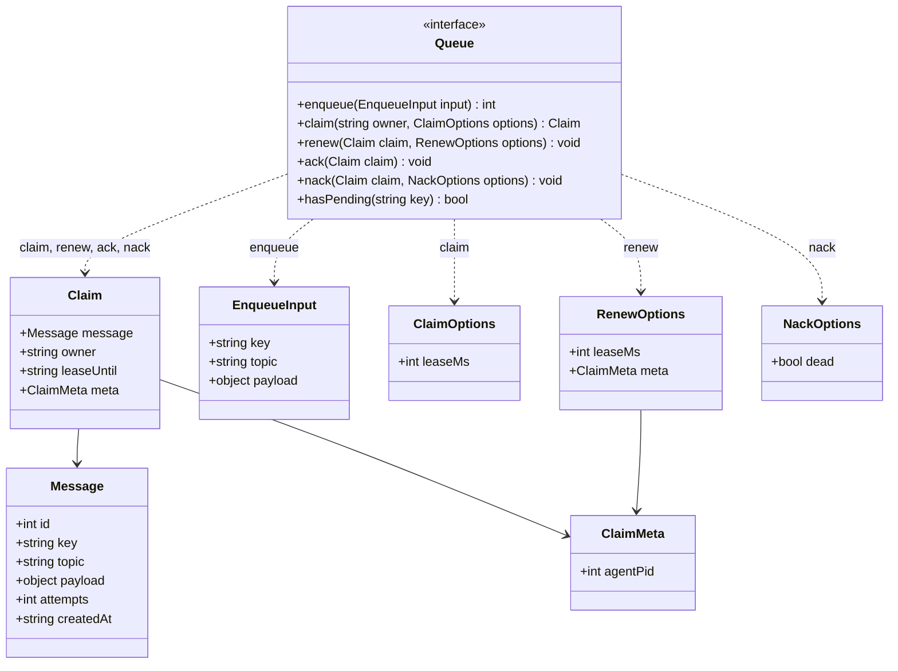
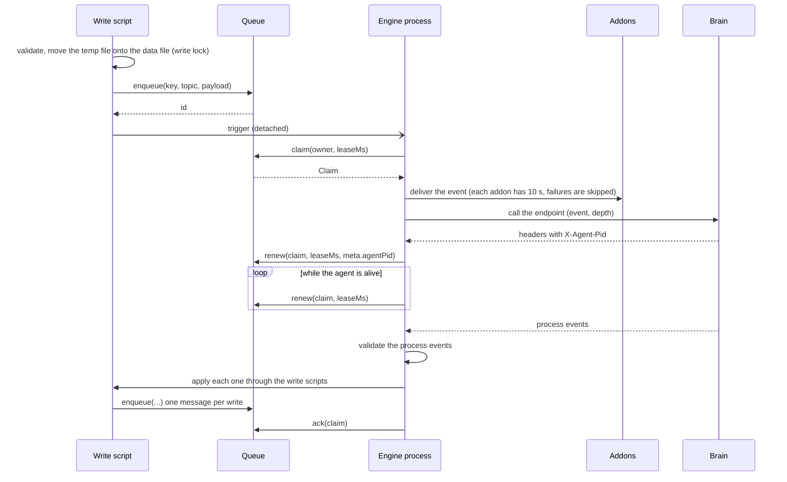
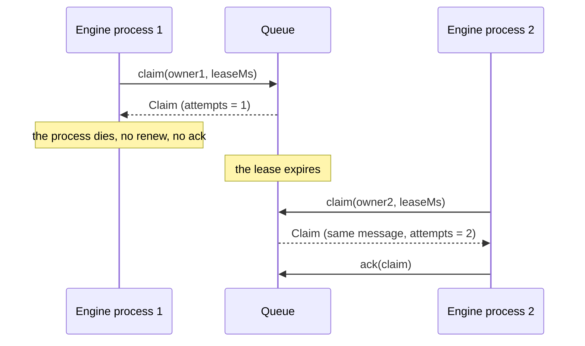
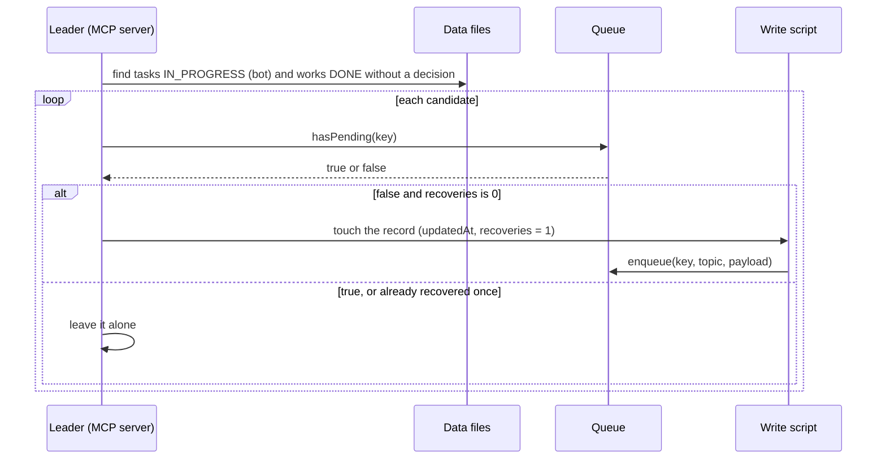
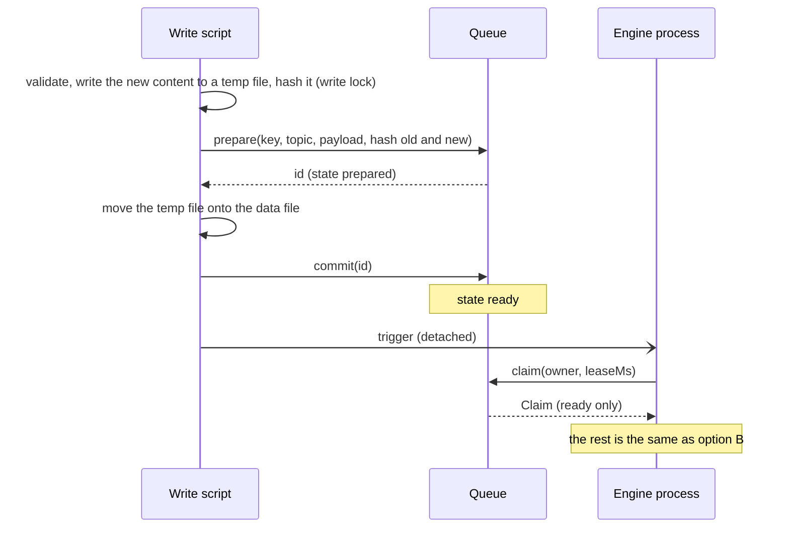
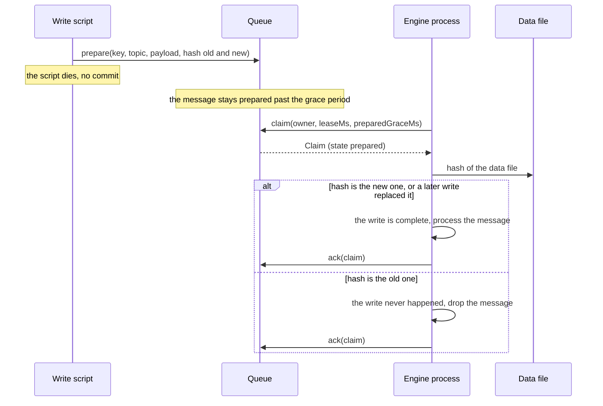
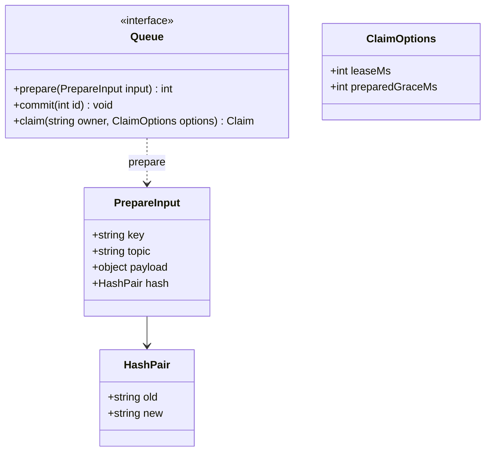

# Queue

Draft. The interface of the queue that holds the engine's events (`_event`, a message in the queue). The backend (SQLite or files) is chosen later: the engine depends only on this interface.

## Principles

- A message is runtime data, not project data. It is not in git and the queue can be deleted safely: the data files are the source of truth, and the recovery of the leader rebuilds what is missing from them.
- Pull model, no daemon. A short-lived engine process claims one message, works on it and exits.
- A claim is a lease. A message whose lease has expired goes back to the queue, so a dead engine process needs no manual cleanup.
- The queue knows nothing about hashes, temp files or data files. Retry, backoff, routing to brains and fan-out to addons stay in the engine.

## Model

| Field                | Meaning                                                                                                                       |
| -------------------- | ----------------------------------------------------------------------------------------------------------------------------- |
| `Message.id`         | Order in the queue. Never reused within one queue. It is not the identity of a record.                                        |
| `Message.key`        | The record the message is about, as `{entity}/{id}` such as `_task/5`. Used by recovery to know if a record has work waiting. |
| `Message.topic`      | `{entity}:{operation}` such as `_task:update`.                                                                                |
| `Message.attempts`   | How many times the message has been claimed. Incremented on each claim.                                                       |
| `Claim.owner`        | The identity of the engine process that holds the claim.                                                                      |
| `Claim.leaseUntil`   | When the claim expires. After that another process may claim the message.                                                     |
| `ClaimMeta.agentPid` | The pid of the agent the brain started for this message. Lets recovery know the work is being done.                           |
| `NackOptions.dead`   | Put the message in the dead state instead of back in the queue.                                                               |

| Operation    | Behavior                                                                                                                                                                                                                |
| ------------ | ----------------------------------------------------------------------------------------------------------------------------------------------------------------------------------------------------------------------- |
| `enqueue`    | Adds a message and returns its id. Ids increase.                                                                                                                                                                        |
| `claim`      | Returns the ready message with the lowest id, or null if there is none. Atomic: of several callers, exactly one gets a given message. A message with an expired lease is ready again and its `attempts` is incremented. |
| `renew`      | Extends the lease of a claim and may set its meta, such as `agentPid`. The engine calls it while the agent is alive, so a job of hours keeps its claim.                                                                 |
| `ack`        | The message is processed. It leaves the queue.                                                                                                                                                                          |
| `nack`       | The message was not processed. It goes back to the queue, or to the dead state when `dead` is true.                                                                                                                     |
| `hasPending` | True if a message with this key is waiting or is claimed with a lease that has not expired. Replaces reading the queue and then the claims in the recovery (2.1).                                                       |

## Usage

The first three diagrams follow option B of the open questions (move the data file first, then enqueue). Option A follows after them, for comparison.

### Option B: a write, and the engine processing its message

Several engine processes can run at once, each claiming a different message.

### Both options: an engine process dies

No manual cleanup: the lease expires and the message is claimed again.

### Both options: the leader looks for work nobody is doing

A message that found no brain was acked and is gone, but the state it was about is still on disk. The recovery asks the queue before it touches a record.

### Option A: two phases

The message is stored before the data file is in place, in the state `prepared`, with the hash of the record before and after the write. The write script commits it after the move. The engine claims only `ready` messages.

### Option A: the write script dies between prepare and commit

The message stays `prepared`. After a grace period the queue hands it to an engine process, which checks the data file against the hashes. No polling and no temp path in the message.

What option A adds to the interface:

`Message` gets a `state` (`prepared` or `ready`) and the `hash`. `enqueue` is replaced by `prepare` and `commit`. `claim` returns a `ready` message at once and a `prepared` one only after `preparedGraceMs`, so the engine checks the hashes of those only.

### Comparison

|                        | Option B                                                                       | Option A                                                             |
| ---------------------- | ------------------------------------------------------------------------------ | -------------------------------------------------------------------- |
| Interface              | `enqueue`                                                                      | `prepare`, `commit`, `preparedGraceMs`                               |
| Data file              | Moved first, then the message                                                  | Message first, then the file                                         |
| Script dies in the gap | Message lost. Recovery repairs bot cases (task, work), not addon notifications | Message kept. The engine checks the hashes and processes or drops it |
| Hash and temp file     | None                                                                           | Hash of the record before and after                                  |
| Reading the data file  | Never                                                                          | Only for a `prepared` message past the grace period                  |
| Queue calls per write  | 1                                                                              | 2                                                                    |
| Complexity             | Low                                                                            | Medium: a state, a grace period, a hash check                        |

## Not in the interface

- Retry, backoff and the choice of the next brain: the engine (1).
- Delivery to addons (1.7): the engine, after it claims the message.
- The check that the write of the data file completed: the write script and the engine, see the open questions.

## Open questions

1. Fan-out: one message in the queue and the engine calls the addons itself (current design), or one queue per subscriber.
2. The gap between writing the data file and enqueueing the message:
   - A: two phases (`prepared`, then `ready`) with a hash. Safe, but the interface needs `prepare` and `commit`.
   - B: move the data file first, then enqueue, with no hash and no temp path. A script that dies in the gap loses the message. Recovery repairs the bot cases (task, work), not the addon notifications.
3. Backend: SQLite or files, chosen after the interface is agreed.
