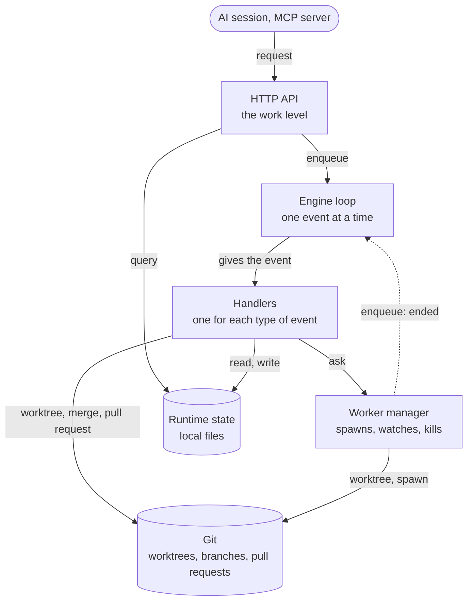

# Engine

The engine is the team lead (see the README): it takes a work, and gives back
the output of the work. It does four things:

- It takes the requests for a work.
- It splits a work into tasks.
- It manages the workers: it spawns them, watches them and kills them.
- It reports the results, and takes the requests to approve or to reject a work.

Everything else is done by git. The documents of the parts it uses:

- `data-struct.md`: the entities, and the statuses that are derived from them.
- `engineloop.md`: the loop that processes the events of the engine.
- `spawn-worker.md`: how a worker is spawned to run a task.

The engine is one process, in the root workspace. There is only one engine
instance for a workspace.

## Git as the platform

The engine does not keep a store for the results or for the approvals. Git is
the platform, and each part of it has a job:

| Git                       | Job                                                        |
| ------------------------- | ---------------------------------------------------------- |
| Worktree                  | An environment of its own for each worker.                 |
| Remote branch             | Where the results are kept.                                |
| Pull request              | The way a work is approved: the approver reviews it there. |
| Merge of the pull request | The way a result is recorded, as rebase and squash.        |

## Data

The data has two kinds, and each kind has one owner.

| Kind       | Owner  | Where                                                                                                                   | Properties                                        |
| ---------- | ------ | ----------------------------------------------------------------------------------------------------------------------- | ------------------------------------------------- |
| Runtime    | Engine | Local files of the root workspace: the progress of the tasks, the works as they were submitted, the pids of the workers | Not in git. Only the engine writes it.            |
| Persistent | Worker | Git: the branch of the worker, on the remote, then the pull request                                                     | In git. The worker writes it in its own worktree. |

The engine writes to git when a work is submitted (the work and the tasks, in
the worktree of the work) and when a work is proposed (the pull request, with
its description). See "Work flow".

## Parts

| Part           | Job                                                                                                                                                           |
| -------------- | ------------------------------------------------------------------------------------------------------------------------------------------------------------- |
| HTTP API       | The only door to the engine. It listens on localhost only, and it works only at the level of the work. It turns a request into an event, and answers a query. |
| Engine loop    | The module of `engineloop.md`: a queue of events and a loop that gives them to the handlers, one at a time, in order.                                         |
| Handlers       | One for each type of event. A handler does the next step of a work (see "Engine loop").                                                                       |
| Worker manager | Prepares the worktree of a task, spawns the worker process, watches it, and kills it (see `spawn-worker.md`). It does the same for the merge agent.           |
| Runtime state  | The local files of the engine: the tasks and their progress, the works as they were submitted, the pids of the workers.                                       |

The worker manager owns the whole life of a worker process: it starts it,
decides when its run has ended, and kills it. No other part touches a worker
process. Everything that needs to act on a worker goes through the worker
manager: a handler asks it, and a client cannot start or stop a worker. When a
worker ends, the worker manager enqueues an event.

The merge agent is a role, and it is spawned in a worktree like a worker. It is
only not made abstract like the worker role. A worker role is concrete when it
is put to use: a developer, a designer, a business analyst. The failure of the
merge agent is handled like the failure of a worker.

The HTTP API works only at the level of the work. The tasks, the workers and the
worktrees are the business of the engine, and a client has no command for them.

## Engine loop

Every change of a work goes through the engine loop, as an event: a request of a
client, or a fact such as "a worker has ended". The loop gives the events to the
handlers one at a time, in order, for all the works. So two events never change
the state at the same time, and a step such as the pull request cannot be done
twice by two events at the same time.

| Event          | Raised by      | What its handler does                                                                                                                                                                |
| -------------- | -------------- | ------------------------------------------------------------------------------------------------------------------------------------------------------------------------------------ |
| `work:submit`  | HTTP API       | Finds the workflow, creates the task graph, creates the worktree of the work from the root branch and writes the work and the tasks in it, then starts the tasks that are ready.     |
| `worker:ended` | Worker manager | Records the result of the task: done, or failed with an `error`. Starts the tasks that are ready now. When all the tasks are done, asks the worker manager to merge the final tasks. |
| `merger:ended` | Worker manager | Opens the pull request, and removes the worktree of the work.                                                                                                                        |
| `work:decide`  | HTTP API       | When approved, merges the pull request and pulls the root branch. When rejected, closes the pull request.                                                                            |

The names of the events are a proposal.

A handler follows the two rules of `engineloop.md`:

- **It does not wait for a long job.** It starts the job and returns. A worker,
  or the merge agent, enqueues an event when it ends, and that event is
  processed in its turn.
- **It can be done again.** An event is given at least once: if the engine stops
  in the middle of a handler, the event is processed again at the next start.
  Before a step the handler checks that the step is not done yet, so a step is
  never done twice, such as the pull request.

## Work flow

1. **Submit.** A client submits a work with one request. The engine records that
   the work was given to it, creates the tasks of the work from the steps of its
   workflow, with no other request, and creates the worktree of the work, based
   on the root branch.
2. **Run.** The engine runs the tasks by itself: a task starts when it has its
   inputs. For each task it prepares a worktree and a branch, based on the
   branch of the task it depends on, and spawns a worker. The worker works only
   in its worktree, and its results are kept on its branch, which is on the
   remote.
3. **Propose.** When all the tasks are done, the work is `PROPOSED`. The merge
   agent merges the branches of the final tasks into the worktree of the work.
   The engine pushes its branch, and opens a pull request on GitHub. The
   description of the pull request is a Markdown text that holds the DOD
   checklists of the tasks. GitHub is the only forge that is supported for now.
4. **Decide.** The approver reviews the work in the pull request, and sends the
   decision to the API: approved or rejected. The decision is not stored: the
   merge of the pull request into the root branch is the approval, and the git
   history keeps it. So the work and the engine stay clean, and approving is one
   atomic action, with nothing else to update. If the work is rejected, the
   engine closes the pull request and keeps the branch. A rejected work is
   final: to try again, a new work is submitted.
5. **Merge.** When the work is approved, the engine merges the pull request into
   the root branch, as rebase and squash. This merge is the approval. The engine
   then pulls the root branch, so the root workspace has the result.

A task is not run again. If its worker fails (the process fails, it is killed
because it runs too long, or its result does not match the schema), the whole
work fails. The worker manager kills the other workers of the work at once, to
save the cost, and the tasks that have not started never start. A failed work is
final, like a rejected one: to try again, a new work is submitted. A failed task
is recorded as `completed` with an `error`, so it is `FAILED` (see "Derived
status" in `data-struct.md`).

## Life cycle

1. **Start:**
   1. Start the engine loop, with the handlers registered. Its start stage
      recovers the events that were left (see `engineloop.md`).
   2. Open the HTTP API, after the start stage of the engine loop is done,
      because `enqueue()` needs it.
   3. For each pid in `.superteam/.r/workers/{pid}.pid`: kill the process if it
      is alive, and enqueue an event that its worker has failed. The engine
      manages the workers, so a worker that is running without the engine would
      be stalled. This step handles a crash and a shutdown in the same way.
2. **Run:** the API turns the requests into events, and the engine loop gives
   them to the handlers.
3. **Shutdown:** on `SIGINT` or `SIGTERM` the engine stops taking requests,
   kills the workers that are running at once, and shuts the engine loop down.
   The pids of the killed workers stay in their files: the next start records
   their tasks as failed, so their works fail. A second signal is a force quit,
   and the next start recovers from it.

## Known issues

- GitHub is the only forge that is supported.
- One event is processed at a time, for all the works. A handler that works
  slowly makes all the works wait.

## Open questions

These are not decided yet.

1. **A ready signal.** `start()` of the engine loop resolves only after the
   shutdown, and `enqueue()` is rejected before the start stage is done. The
   engine needs a way to know that the start stage is done, to open the API at
   the right time.
2. **The HTTP API.** The list of the requests and the queries at the level of
   the work. The ones named so far are: submit a work, approve it, reject it,
   and get the status and the output of a work.
3. **The runtime state.** Its layout, and the fields of the record of a work.
   `storage.md` has to be written again for this structure.
4. **The approval status.** It is derived from git: the pull request is open
   (`PROPOSED`), merged (`APPROVED`), or closed without a merge (`REJECTED`).
   `data-struct.md` still has `approved` and `approvalAt` on the work, and
   formulas that use them.
5. **The module of `eventloop.md`.** The engine does not use it. Is it kept as
   an independent module, or removed?
