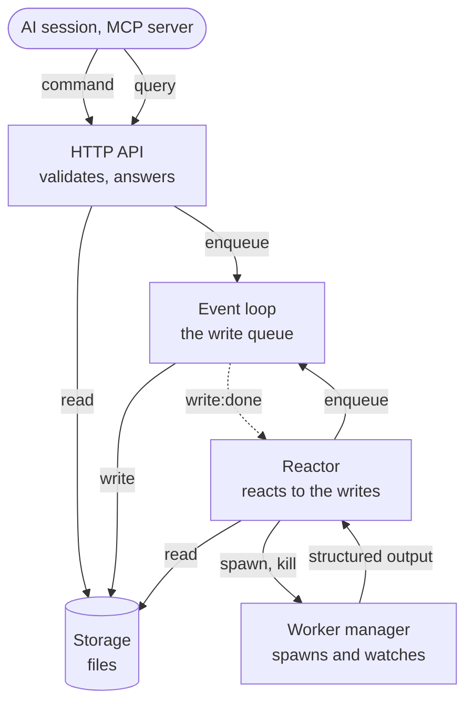

# Engine

The engine is the process that replaces the team lead (see the README). It owns
the workflow logic and all the state. This document describes how the engine is
put together. The parts it uses are described in their own documents:

- `data-struct.md`: the entities, and the statuses that are derived from them.
- `eventloop.md`: the write queue and the loop that processes it.
- `spawn-worker.md`: how a worker is spawned to run a task.

The engine is one process, in the root workspace. There is only one engine
instance for a workspace.

## Parts

| Part           | Job                                                                                                                                                        |
| -------------- | ---------------------------------------------------------------------------------------------------------------------------------------------------------- |
| HTTP API       | The only door to the engine. It listens on localhost only. It turns a command into a write command for the queue, and it answers a query from the storage. |
| Event loop     | The module of `eventloop.md`. It is the only part that writes to the storage of the root branch. It knows nothing of the other parts.                      |
| Storage        | The files that hold the state. Only part of it is versioned with git. Runtime data is not.                                                                 |
| Reactor        | Subscribes to the notifications of the event loop. When a write is done, it checks what the new state allows, and it makes the next thing happen.          |
| Worker manager | Spawns the worker process of a task, watches it, and kills it when it runs too long (see `spawn-worker.md`).                                               |

The worker manager owns the whole life of a worker process: it starts it,
decides when its run has ended, and kills it. No other part touches a worker
process. Everything that needs to act on a worker goes through the worker
manager: the reactor asks it, and a client cannot start or stop a worker.

## Work flow

The engine is the team lead: it takes a work and gives back the output of the
work. The HTTP API works only at the level of the work. The tasks, the workers
and the worktrees are the business of the engine, and a client has no command
for them.

1. **Submit.** A client submits a work with one request. The engine creates the
   work, and it creates the tasks of the work from the steps of its workflow,
   with no other request.
2. **Run.** The engine runs the tasks by itself: a task starts when it has its
   inputs.
3. **Propose.** When all the tasks are done, the work is `PROPOSED`. The merge
   agent merges the branches of the final tasks into one branch of the work. The
   engine pushes this branch and opens a pull request on GitHub, which is where
   the approver reviews the output of the work. The description of the pull
   request is a Markdown text that holds the DOD checklists of the tasks, so the
   approver sees them together with the artifacts. GitHub is the only forge that
   is supported for now.
4. **Decide.** The approver sends the decision to the API: approved or rejected.
   The decision is recorded in the work. The pull request is not the source of
   truth. If the work is rejected, the engine closes the pull request and keeps
   the branch. A rejected work is final: to try again, a new work is submitted.
5. **Merge.** When the work is approved, the engine merges the pull request into
   the root branch.

A task is not run again. If its worker fails (the process fails, it is killed
because it runs too long, or its result does not match the schema), the whole
work fails. The worker manager kills the other workers of the work at once, to
save the cost, and the tasks that have not started never start. A failed work is
final, like a rejected one: to try again, a new work is submitted.

## Write flow (command)

CQRS: a command never changes the storage by itself. It becomes an event of the
write queue, and the event loop applies it.

1. The client calls the HTTP API with a command, such as "submit a work" or
   "approve a work".
2. The API validates the command against the current state, including the
   version (see "Version"). If it is not valid, it answers with an error, and
   nothing is enqueued.
3. The API builds the write command (`payload`) of the event loop: the whole new
   content of the file that holds the entity, the `target` path of that file,
   and the `version` the command was built from.
4. The API calls `eventloop.enqueue(payload)`, and answers at once with the `id`
   of the event. It does not wait for the write to be processed.
5. The event loop applies the write, and fires `write:done`, `write:retry` or
   `write:error`.

A write is accepted, not done. The client can follow its event: when the
notification of that `id` is `write:done`, the state is up to date. A stale
write is not retried by the event loop, because a retry would be stale again.
The client handles it: it reads the entity again. If its change is already
there, the command was applied before, and there is nothing more to do. If not,
it builds a new command from the new state and sends it. This is a retry at a
higher level than the retry of the event loop.

## Version

Every entity has a `version`, an integer. It tells the engine that a write was
built from an old state (a stale write). It protects against two cases: a
command that is sent again after it was applied (a retry), and a command built
from an old state when two actors write the same entity. The second case is not
expected (see "Entity design" in `data-struct.md`), but it is not prevented
either.

- A new entity has the version `1`. The command that creates it carries the
  version `0`: the file must not exist yet.
- A command that changes an entity carries the `version` it read. The new
  content it builds has the version plus one.
- When the write is applied, the version in the command is compared with the
  version of the file that is on the disk. If they are the same, the write is
  done. If they are not, the write is stale: it is not applied, and it is not
  retried, because a retry would be stale again. The event goes to the DLQ, and
  `write:error` is fired.
- The check must be made when the write is applied, not when the command is
  accepted. Between the two, other events can change the entity. The event loop
  applies one event at a time, so the check at that point has no race.
- The check in step 2 of the write flow is only an early answer for the client.
  It does not replace the check at the apply time.

## Read flow (query)

A query reads the files of the storage directly. It never goes through the
queue, so it is fast and it does not wait for the writes that are in the queue.

The state a query sees can be a little behind the commands that are accepted but
not yet applied. The engine does not hide this: it is the price of the
asynchronous write flow.

## Reactor

The state is not stored with its statuses: they are derived (see "Derived
status" in `data-struct.md`). So nothing "changes" a task to `IN_PROGRESS`. The
reactor finds out what is true after each write, and acts on it.

On each `write:done`, the reactor reads the entities that the write touched and
derives their status. Then it reacts:

| What became true                            | What the reactor does                                                    |
| ------------------------------------------- | ------------------------------------------------------------------------ |
| A task is `IN_PROGRESS` and has no worker   | Asks the worker manager to spawn a worker for it.                        |
| A worker has returned its structured output | Enqueues the writes: the artifacts, the DOD checklist, and `completed`.  |
| A worker has failed or has been killed      | Records the failure on the task, and does not spawn it again on its own. |
| The approval status of a work is `APPROVED` | Asks the worker manager to spawn the merge agent for the final tasks.    |

The reactor never writes to the storage itself. It only enqueues writes, so
everything it does goes through the same single queue, in order.

## Storage

The storage is file-based, under `{baseDir}/.superteam/`. The event loop owns
`.superteam/.w/` (the queue, the claim, the DLQ and the tmp folders). The rest
is the state of the entities in `data-struct.md`.

The event loop writes a whole file, and it writes to any `target` path. So an
entity is one file, and its path comes from its identity.

## Life cycle

1. **Start:**
   1. Create the event loop with the `baseDir` of the workspace, and subscribe
      the reactor to its notifications.
   2. Start the event loop. Its start stage recovers from a crash (see
      `eventloop.md`).
   3. Open the HTTP API, after the start stage of the event loop is done,
      because `enqueue()` needs it.
   4. Reconcile with the workers that were running before the engine stopped.
2. **Run:** the API takes the commands and the queries, the event loop processes
   the writes, and the reactor reacts to them.
3. **Shutdown:** on `SIGINT` or `SIGTERM` the engine stops taking requests, and
   calls `shutdown()` of the event loop, which finishes the write in progress. A
   second signal is a force quit, and the next start recovers from it.

## Known issues

The engine is made for an internal tool. These limits come from the way it
works, and they are accepted:

- Two actors that write the same entity are not expected, but they are not
  prevented. The later write is rejected as stale, and the client decides what
  to do.
- A query can see a state that is behind the commands that are accepted but not
  yet applied.

## Open questions

These are not decided yet.

1. **The `version` field.** `data-struct.md` does not have it on the entities
   yet. The event loop already checks it (see `eventloop.md`).
2. **The storage layout.** Decided in `storage.md`, which has its own open
   questions.
3. **The HTTP API.** The list of the commands and the queries, and the way a
   client follows an event until it is done.
4. **A ready signal.** `start()` of the event loop resolves only after the
   shutdown, and `enqueue()` fails before the start stage is done. The engine
   needs a way to know that the start stage is done, to open the API at the
   right time.
5. **The engine restarts.** What happens to a task whose worker was running when
   the engine stopped: the pid may be alive, or dead, and the work may be half
   done in a worktree.
