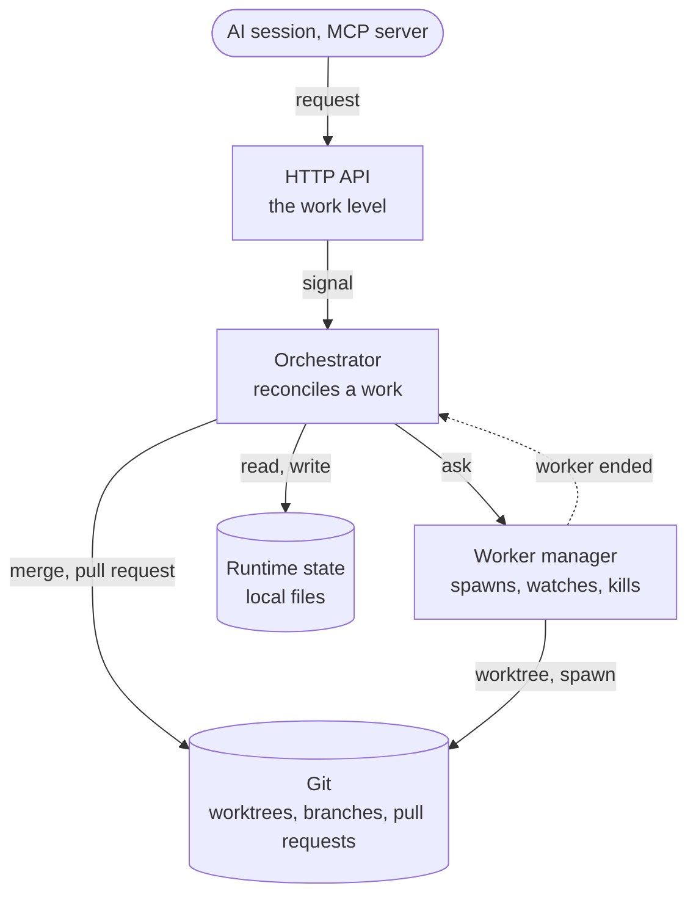

# Engine

The engine is the team lead (see the README): it takes a work, and gives back
the output of the work. It does four things:

- It takes the requests for a work.
- It splits a work into tasks.
- It manages the workers: it spawns them, watches them and kills them.
- It reports the results, and takes the requests to approve or to reject a work.

Everything else is done by git. The documents of the parts it uses:

- `data-struct.md`: the entities, and the statuses that are derived from them.
- `spawn-worker.md`: how a worker is spawned to run a task.

The engine is one process, in the root workspace. There is only one engine
instance for a workspace.

## Git as the platform

The engine does not keep a store for the results or for the approvals. Git is
the platform, and each part of it has a job:

| Git                       | Job                                                        |
| ------------------------- | ---------------------------------------------------------- |
| Worktree                  | An environment of its own for each worker.                 |
| Remote branch             | Where the results are kept.                                |
| Pull request              | The way a work is approved: the approver reviews it there. |
| Merge of the pull request | The way a result is recorded, as rebase and squash.        |

## Data

The data has two kinds, and each kind has one owner.

| Kind       | Owner  | Where                                                                                                                   | Properties                                        |
| ---------- | ------ | ----------------------------------------------------------------------------------------------------------------------- | ------------------------------------------------- |
| Runtime    | Engine | Local files of the root workspace: the progress of the tasks, the works as they were submitted, the pids of the workers | Not in git. Only the engine writes it.            |
| Persistent | Worker | Git: the branch of the worker, on the remote, then the pull request                                                     | In git. The worker writes it in its own worktree. |

The engine writes to git only at one point: when a work is proposed, it writes
the work and the description of the pull request (see "Work flow").

## Parts

| Part           | Job                                                                                                                                                         |
| -------------- | ----------------------------------------------------------------------------------------------------------------------------------------------------------- |
| HTTP API       | The only door to the engine. It listens on localhost only, and it works only at the level of the work. It tells the orchestrator what the client asked for. |
| Orchestrator   | Moves a work to its next step (see "Orchestrator").                                                                                                         |
| Worker manager | Prepares the worktree of a task, spawns the worker process, watches it, and kills it (see `spawn-worker.md`). It does the same for the merge agent.         |
| Runtime state  | The local files of the engine: the tasks and their progress, the dispatch records, the pids of the workers.                                                 |

The worker manager owns the whole life of a worker process: it starts it,
decides when its run has ended, and kills it. No other part touches a worker
process. Everything that needs to act on a worker goes through the worker
manager: the orchestrator asks it, and a client cannot start or stop a worker.

The merge agent is a role, and it is spawned in a worktree like a worker. It is
only not made abstract like the worker role. A worker role is concrete when it
is put to use: a developer, a designer, a business analyst. The failure of the
merge agent is handled like the failure of a worker.

The HTTP API works only at the level of the work. The tasks, the workers and the
worktrees are the business of the engine, and a client has no command for them.

## Orchestrator

The orchestrator moves a work step by step. For one work, it does a
reconciliation:

1. It reads what exists: the tasks and their progress, the workers, the
   branches, the pull request.
2. It derives the statuses (see "Derived status" in `data-struct.md`).
3. It does the next step that is missing, and only that step: it starts a
   worker, merges the final branches, opens the pull request, or merges it.

The reconciliation is called again each time something happens to the work:

- A client submits the work, or approves it, or rejects it.
- A worker ends, or is killed.
- The engine starts: it reconciles every work.

These are the rules of the orchestrator:

- A reconciliation can be done again: before a step it checks that the step is
  not done yet, so a step is never done twice, such as the pull request.
- The reconciliations of one work are done one at a time. The ones of different
  works run at the same time.
- A reconciliation never waits for a long job. It starts the job and returns. A
  worker, or the merge agent, signals the work when it ends, and the work is
  reconciled again.
- The signals are kept in memory, and they carry only the id of a work. After a
  restart no signal is left, so the engine reconciles every work when it starts.

## Work flow

1. **Submit.** A client submits a work with one request. The engine records that
   the work was given to it (the dispatch), and creates the tasks of the work
   from the steps of its workflow, with no other request.
2. **Run.** The engine runs the tasks by itself: a task starts when it has its
   inputs. For each task it prepares a worktree and a branch, and spawns a
   worker. The worker works only in its worktree, and its results are kept on
   its branch, which is on the remote.
3. **Propose.** When all the tasks are done, the work is `PROPOSED`. The merge
   agent merges the branches of the final tasks into one branch of the work. The
   engine writes the work to this branch, pushes it, and opens a pull request on
   GitHub. The description of the pull request is a Markdown text that holds the
   DOD checklists of the tasks. GitHub is the only forge that is supported for
   now.
4. **Decide.** The approver reviews the work in the pull request, and sends the
   decision to the API: approved or rejected. The decision is not stored: the
   merge of the pull request into the root branch is the approval, and the git
   history keeps it. So the work and the engine stay clean, and approving is one
   atomic action, with nothing else to update. If the work is rejected, the
   engine closes the pull request and keeps the branch. A rejected work is
   final: to try again, a new work is submitted.
5. **Merge.** When the work is approved, the engine merges the pull request into
   the root branch, as rebase and squash. This merge is the approval. The engine
   then pulls the root branch, so the root workspace has the result.

A task is not run again. If its worker fails (the process fails, it is killed
because it runs too long, or its result does not match the schema), the whole
work fails. The worker manager kills the other workers of the work at once, to
save the cost, and the tasks that have not started never start. A failed work is
final, like a rejected one: to try again, a new work is submitted. A failed task
is recorded as `completed` with an `error`, so it is `FAILED` (see "Derived
status" in `data-struct.md`).

## Life cycle

1. **Start:**
   1. Kill the workers that were running before the engine stopped. The engine
      manages the workers, so a worker that is running without the engine would
      be stalled. The pids are in `.superteam/.r/workers/{pid}.pid`. Record the
      tasks of these workers as failed.
   2. Open the HTTP API.
   3. Reconcile every work.
2. **Run:** the API takes the requests, and the orchestrator reconciles the
   works when something happens to them.
3. **Shutdown:** on `SIGINT` or `SIGTERM` the engine stops taking requests,
   kills the workers that are running at once, and records their tasks as
   failed, so their works fail. A second signal is a force quit, and the next
   start recovers from it.

## Known issues

- GitHub is the only forge that is supported.

## Open questions

These are not decided yet.

1. **The request path.** A signal carries only the id of a work, so what a
   client asked (submit, approve, reject) must be in the runtime state before
   the reconciliation reads it. Who writes it, without racing the reconciliation
   of the same work: the API, which waits for the turn of the work, or the
   orchestrator, which takes the request in its own turn?
2. **The write loop.** The engine is a singleton, so it may still need a loop
   for the writes to its runtime state. To be considered. The orchestrator can
   be a separate module that works in memory: it takes the id of a work, merges
   the signals for the same work, and runs one reconciliation at a time for each
   work.
3. **The HTTP API.** The list of the requests and the queries at the level of
   the work. The ones named so far are: submit a work, approve it, reject it,
   and get the status and the output of a work.
4. **The runtime state.** Its layout, and the fields of the record of a work.
   `storage.md` has to be written again for this structure.
5. **The approval status.** It is derived from git: the pull request is open
   (`PROPOSED`), merged (`APPROVED`), or closed without a merge (`REJECTED`).
   `data-struct.md` still has `approved` and `approvalAt` on the work, and
   formulas that use them.
