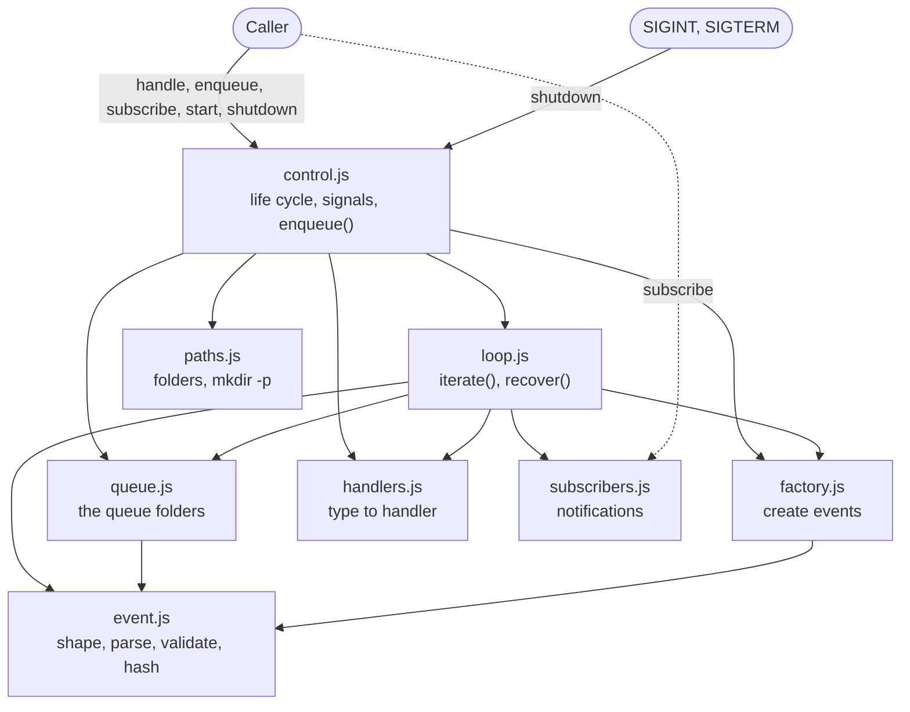

# Engine loop implementation plan

The plan to implement the module described in `engineloop.md`.

The module is new. It is written from scratch, and it does not import or change
the module of `eventloop.md`: the two are independent. The structure is the same
because it worked well, but each file is a new file.

## 1. Scope

- In scope: the engine loop module, as `engineloop.md` describes it: the queue,
  the claim and DLQ folders, the event and the factory, the handlers, the loop,
  the life cycle, and the subscribers.
- Out of scope: the engine, the HTTP API, the handlers themselves (what a
  `work:submit` does), and the orchestration. The module does not know them.

## 2. Decisions

| Topic               | Decision                                                                                                                                                                                                                                                         |
| ------------------- | ---------------------------------------------------------------------------------------------------------------------------------------------------------------------------------------------------------------------------------------------------------------- |
| Language            | JavaScript, ES modules, Node 24. No runtime dependency.                                                                                                                                                                                                          |
| Location            | `superteam-engine/src/lib/engineloop/`. Each unit test is next to its code: `paths.js` has `paths.test.js`.                                                                                                                                                      |
| Test runner         | `node:test` and `node:assert`. No extra dependency.                                                                                                                                                                                                              |
| Base directory      | A `baseDir` option. The folders are `{baseDir}/.superteam/.e/{queue,claim,dlq,tmp}`.                                                                                                                                                                             |
| Folders             | Created with `mkdir -p` at start.                                                                                                                                                                                                                                |
| Hash                | SHA-256, hex. `id` is the hash of `createdAt` and `order`.                                                                                                                                                                                                       |
| `createdAt`         | `new Date().toISOString()`, UTC, to the millisecond.                                                                                                                                                                                                             |
| Temporary file name | A random uuid with the `.tmp` extension, in `.superteam/.e/tmp/`.                                                                                                                                                                                                |
| Validation          | A hand-written validator for the event. The payload needs a string `type` and an object `data`, and nothing more. No schema library.                                                                                                                             |
| Handlers            | A registry that maps a `type` to one handler. `handle(type, handler)` throws if the type already has a handler, or if the loop has started. The loop gets a handler by `type`.                                                                                   |
| Handler call        | `await handler(event)`. A handler succeeds when it returns, and fails when it throws. The loop does not read what it returns.                                                                                                                                    |
| Not retryable       | An error with `retryable === false` goes to the DLQ at once, with the error added to `errors` and `event:error`. The loop knows only the flag.                                                                                                                   |
| No handler          | An event whose `type` has no handler goes to the DLQ at once, like an event with a wrong structure: it is never retried.                                                                                                                                         |
| Subscribers         | Called in the order of the subscription, not awaited. A `try` and `catch` only isolates an error of a subscriber from the loop.                                                                                                                                  |
| Options             | `createEngineLoop` takes `maxAttempts` (3), `pollIntervalMs` (1000), `sleep` and `now` (for tests).                                                                                                                                                              |
| Claim name          | `{id}.json`. An event that has no valid `id` (broken JSON, or an `id` that is not a hash) uses its queue file name, such as `000003.json`.                                                                                                                       |
| `errors` field      | An event has `errors`, a required array of `{ attempt, error, time }`: `attempt` counts from 1, `error` is the message, `time` is ISO. `create()` gives `[]`, and `createAtHead(payload, attempts, errors)` keeps the errors.                                    |
| DLQ file            | `toDlq(name, event)` writes the given event to the DLQ (atomic) and deletes the claim, so the file of an event that failed for good has the last error. Without `event` it only moves the claim.                                                                 |
| Notifications       | `event:done` carries the event and `time`. `event:retry` and `event:error` carry the event with the error of this attempt added to `errors`, and an extra `error` (the reason, as text). For a broken event, `event` is the parsed object, or `null`.            |
| Abandoned claim     | A claim that is left, at the start or at the top of an iteration, is put back at the head of the queue as `000000.json`, with the same `attempts` and `errors`, and it is processed again. A claim that is not valid goes to the DLQ and `event:error` is fired. |
| Counter             | Increased synchronously in `create()`, so two calls in the same process never get the same `order`.                                                                                                                                                              |
| `order` limit       | `create()` throws `order above 999999 is not supported` when the counter reaches the maximum.                                                                                                                                                                    |
| Tmp clean-up        | The start stage deletes every file in `.superteam/.e/tmp/` (`clearTmp()`), before the recovery.                                                                                                                                                                  |
| `start()` guard     | `start()` throws `start() can be called only once` on a second call, also after `shutdown()`.                                                                                                                                                                    |
| Force quit          | A second `SIGINT` or `SIGTERM` calls `exit(130)` at once. The claim stays, and the next start recovers from it. `shutdown()` called by code does not count. `exit` is an option of the control, for tests.                                                       |
| Fail fast           | An error of the file system inside `iterate()` is not caught: `start()` rejects and the loop stops. A claim that is left is recovered at the next start.                                                                                                         |

## 3. Code style

- Short code, fully commented with `//` comments.
- Separation of concerns is the first priority: each file does one job, as the
  layout in section 4 shows, and does not know the jobs of the others.
- SOLID also applies, but not in the OOP form: plain functions and modules, no
  classes.
- Braces on every `if`, and an object literal with a property breaks the line
  after its opening brace (the rules of ESLint and Prettier of the project).

## 4. Layout

```
superteam-engine/src/lib/engineloop/
  index.js            createEngineLoop(options): puts the parts together, no logic
  index.test.js       the flow tests of the whole module
  paths.js            the folders of the module, mkdir -p, and clearTmp
  paths.test.js
  event.js            the event shape, parsing, validation, and the hashes
  event.test.js
  factory.js          the counter, and create events: it does not know the queue
  factory.test.js
  queue.js            the queue folders: put, list, claim, delete a claim, move to the DLQ
  queue.test.js
  handlers.js         the registry of the handlers: register and get by type
  handlers.test.js
  subscribers.js      subscribe and emit, with the errors isolated
  subscribers.test.js
  loop.js             one iteration and the recovery: the work on the events
  loop.test.js
  control.js          the life cycle of the loop, the signals, and enqueue()
  control.test.js
```

How the files relate. An arrow means "uses". `index.js` creates every part and
passes it to the parts that need it, so its arrows are left out. `event.js` and
`paths.js` are at the bottom: they use no other file.



## 5. Public API

```js
const loop = createEngineLoop({ baseDir, maxAttempts, pollIntervalMs });

loop.handle(type, handler); // registers the handler of a type, before start()
loop.enqueue(payload); // Promise<event>: creates the event and puts it in the queue
loop.subscribe(name, handler); // returns a function that unsubscribes
await loop.start(); // runs the start stage, then the loop, and resolves after shutdown
loop.shutdown(); // sets isShuttingDown to true
```

- `handle()` throws if the type already has a handler, or if `start()` was
  called.
- `start()` also adds the `SIGINT` and `SIGTERM` handlers. The first signal
  calls `shutdown()`. A second signal is a force quit: it calls `exit(130)` at
  once, and the next start recovers from the claim that is left. The option
  `handleSignals: false` turns the handlers off, for tests.
- `start()` can be called only once. A second call, also after `shutdown()`,
  throws `start() can be called only once`.
- `start()` is fail fast: an error of the file system inside the loop makes the
  promise reject, and the loop stops.
- `enqueue()` is rejected with `enqueue() needs start() first` if it is called
  before `start()` has finished its start stage. A handler can call it while the
  loop runs.

## 6. Steps

Each step comes with the unit test file of its code, next to it. A step ends
with its tests passing before the next step starts.

1. **Foundation** (`paths.js`, `event.js`): the folders, `ensurePaths()`,
   `clearTmp()`, the event shape (`payload` with `type` and `data`, and
   `errors`), the parsing of an event file, the validator, the hash functions,
   and the padding of `order` to 6 digits.
2. **Factory** (`factory.js`): the counter, `create()` with `order`, `id`,
   `createdAt` and `errors` `[]`, and `createAtHead()` with the `order` `0`, for
   the retry and the recovery, which keeps the `errors`. `create()` throws when
   `order` would pass `999999`. The factory does not know where the events go.
3. **Queue** (`queue.js`): the only place that knows the queue folders. `put()`
   writes an event atomically (write to tmp, then move into the queue), and
   overwrites a file with the same name. It also lists the queue in `order`,
   finds the maximum `order`, claims the lowest event by moving it, lists the
   claims, reads and deletes a claim, and moves an event to the DLQ (with an
   updated event when it is given).
4. **Handlers** (`handlers.js`): register a handler for a `type`, and get it. A
   type has one handler. It does not know the loop.
5. **Subscribers** (`subscribers.js`): subscribe, unsubscribe, and emit with
   each handler in a try and catch.
6. **Loop** (`loop.js`): `iterate()`, one iteration of `loop()`, with the steps
   of `engineloop.md`: put an abandoned claim back, claim a new event and wait
   `2^attempts` seconds for a retry, call the handler of its `type`, then delete
   the claim and fire `event:done`, or retry with `event:retry`, or go to the
   DLQ with `event:error`. An event that is not valid, an event with no handler
   and an error with `retryable` false are never retried. `recover()` puts each
   abandoned claim back at the head of the queue as `000000.json`, with the same
   `attempts` and `errors`, and overwrites the file if it exists. The loop knows
   nothing of its own life cycle: it has no flag, no signal and no wait for an
   empty queue.
7. **Control** (`control.js`, `index.js`): the life cycle of the loop. `start()`
   is the three stages of `engineloop.md`: the start stage makes the folders
   (`ensurePaths()`), clears the tmp folder (`clearTmp()`), finds the maximum
   `order` and sets the counter, and calls `loop.recover()`; then it sets
   `isStarted`. The loop stage calls `loop.iterate()` again and again, and waits
   1 second when the queue is empty. The shutdown stage is `shutdown()`, which
   sets `isShuttingDown`, checked before each new iteration. The control also
   owns the `SIGINT` and `SIGTERM` handlers (the first signal calls
   `shutdown()`, the second one calls `exit(130)`), the guard that lets
   `start()` run only once, and `enqueue()`, which needs `isStarted`, so
   `enqueue()` never runs while the counter is not right. `exit` is an option of
   the control, for tests. `index.js` puts the parts together and gives the
   public API.

## 7. Tests

Unit tests, each in the `.test.js` file next to its code:

- `paths.test.js`: the folders are the right ones, they are created when they
  are missing, and `clearTmp()` deletes what is left in the tmp folder.
- `event.test.js`: the padding of `order`, the `id`, the validator (the `type`,
  the `data`, and the checks of `errors`), and the parsing of an event file.
- `factory.test.js`: 100 calls of `create()` at the same time give 100 different
  `order`, `create()` gives `errors` `[]`, `createAtHead()` gives the `order`
  `0` and keeps the `errors`, and `create()` throws above `999999`.
- `queue.test.js`: `put` is atomic and overwrites, the list is in `order`, the
  claim moves the lowest event, and the move to the DLQ, also with an updated
  event.
- `handlers.test.js`: a handler is found by its type, a type with no handler
  gives nothing, and a second handler for the same type throws.
- `subscribers.test.js`: the function that `subscribe()` returns unsubscribes
  the handler, and a subscriber that throws does not stop the other subscribers.
- `loop.test.js`: one iteration with fakes for the parts it uses, the wait of
  `2^attempts` seconds, the retry with the error added to `errors`, the DLQ with
  the last error, an event with no handler, an error that is not retryable, and
  `recover()`.
- `control.test.js`: with a fake loop, the order of the three stages, the wait
  when the queue is empty, the check of `isShuttingDown`, `enqueue()` before and
  after the start stage, the clean-up of the tmp folder, the guard of `start()`,
  and the signals (`process.emit`, no real signal): the first one calls
  `shutdown()`, the second one calls the fake `exit` with `130`, a `shutdown()`
  from code does not count as a signal, and the handlers are removed after
  `start()`.

Flow tests, in `index.test.js` because `index.js` puts all the parts together.
They go through the public API, with the folders prepared on a temporary disk
folder and `sleep` replaced. `enqueue()` needs `start()` first, so a helper
`seed()` writes the events into the queue by hand, as if an earlier run left
them:

- `enqueue()` before `start()` is rejected.
- An event is processed: its handler is called with the event, the claim is
  deleted, and `event:done` carries the event and the `time`.
- The events are processed one at a time, in `order`.
- A handler fails: the new event is `000000.json` with `attempts` plus one and
  the error in `errors`, and `event:retry` is fired. The loop waits `2^attempts`
  seconds before the retry.
- `attempts` reaches `maxAttempts`: the DLQ file has the error of every attempt,
  the last one too, and `event:error` is fired.
- An error with `retryable` false goes to the DLQ at once, without a retry or a
  wait.
- An event with no handler for its `type`, an event with a wrong structure and
  one that is not valid JSON go to the DLQ without a retry.
- A handler that enqueues an event: the new event is processed after the current
  one.
- Start with a claim: it becomes `000000.json`, it overwrites an existing
  `000000.json`, and the event is processed again. The counter starts at the
  maximum `order` of the queue, and at 0 when the queue is empty.
- The tmp folder is empty after the start stage.
- A second call of `start()` throws.
- Shutdown during an iteration: the iteration finishes, and no new one starts.
- The `claim` folder never has more than one file.

Run all the tests with `npm test`. It uses a glob, because Node 24 does not take
a folder.
