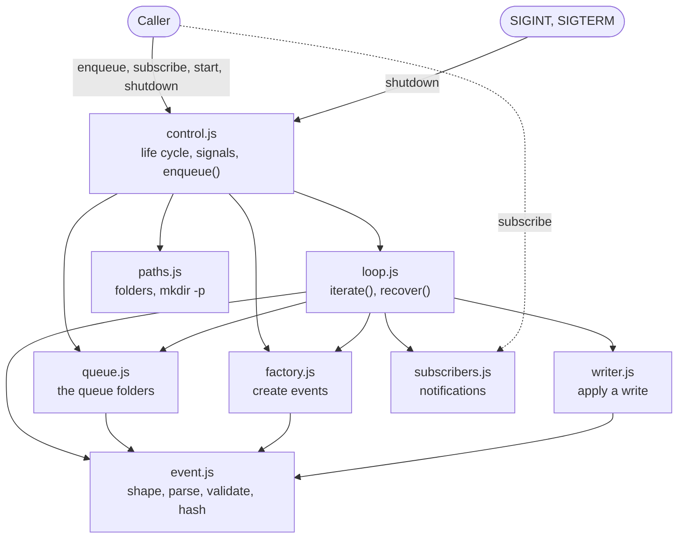

# Event loop implementation plan

The plan to implement the module described in `eventloop.md`.

## 1. Scope

- In scope: the event loop module, as `eventloop.md` describes it: the queue,
  the claim and DLQ folders, the event and the factory, the loop, the life
  cycle, and the subscribers.
- Out of scope: the engine, the HTTP API, the reactor that listens to the
  notifications, and the storage layout. The module does not know them.

## 2. Decisions

| Topic               | Decision                                                                                                                                                                           |
| ------------------- | ---------------------------------------------------------------------------------------------------------------------------------------------------------------------------------- |
| Language            | JavaScript, ES modules, Node 24. No runtime dependency.                                                                                                                            |
| Location            | `superteam-engine/src/eventloop/`. Each unit test is next to its code: `paths.js` has `paths.test.js`.                                                                             |
| Test runner         | `node:test` and `node:assert`. No extra dependency.                                                                                                                                |
| Base directory      | A `baseDir` option. The folders are `{baseDir}/.superteam/.w/{queue,claim,dlq,tmp}`.                                                                                               |
| Folders             | Created with `mkdir -p` at start.                                                                                                                                                  |
| Hash                | SHA-256, hex. `id` is the hash of `createdAt` and `order`. The `hash` of `write:done` is of the bytes.                                                                             |
| `createdAt`         | `new Date().toISOString()`, UTC, to the millisecond.                                                                                                                               |
| Content             | Written as bytes (`Buffer`), so a binary file such as an image is kept as it is.                                                                                                   |
| `remoteSrc`         | `file://` with `fs.readFile`, `http(s)` with the global `fetch`, `GET` only. A timeout of 30 seconds.                                                                              |
| Temporary file name | A random uuid with the `.tmp` extension, in `.superteam/.w/tmp/`.                                                                                                                  |
| Validation          | A hand-written validator for the event and the payload. No schema library.                                                                                                         |
| Subscribers         | Called in the order of the subscription, not awaited. A `try` and `catch` only isolates an error of a subscriber from the loop: handling it is out of the scope of the event loop. |
| Options             | `createEventLoop` takes `maxAttempts` (3), `pollIntervalMs` (1000), `sleep` and `now` (for tests). `start()` takes `fetchTimeoutMs` (30000).                                       |
| Claim name          | `{id}.json`. An event that has no valid `id` (broken JSON, or an `id` that is not a hash) uses its queue file name, such as `000003.json`.                                         |
| Error notifications | `write:error` and `write:retry` carry an extra `error` (the reason, as text). For a broken event, `event` is the parsed object, or `null`.                                         |
| Broken claim        | At the recovery, a claim that is not valid goes to the DLQ and `write:error` is fired. An abandoned claim found by `loop()` only goes to the DLQ: no notification.                 |
| `target`            | The writer creates the parent folder of `target` (`mkdir -p`) before it moves the file.                                                                                            |
| Counter             | Increased synchronously in `create()`, so two calls in the same process never get the same `order`.                                                                                |

## 3. Code style

- Short code, fully commented with `//` comments.
- Separation of concerns is the first priority: each file does one job, as the
  layout in section 4 shows, and does not know the jobs of the others.
- SOLID also applies, but not in the OOP form: plain functions and modules, no
  classes.

## 4. Layout

```
superteam-engine/src/lib/eventloop/
  index.js            createEventLoop(options): puts the parts together, no logic
  index.test.js       the flow tests of the whole module
  paths.js            the folders of the module, and mkdir -p
  paths.test.js
  event.js            the event shape, parsing, validation, and the hashes
  event.test.js
  factory.js          the counter, and create events: it does not know the queue
  factory.test.js
  queue.js            the queue folders: put, list, claim, delete a claim, move to the DLQ
  queue.test.js
  writer.js           get the content, write to tmp, move to the target
  writer.test.js
  subscribers.js      subscribe and emit, with the errors isolated
  subscribers.test.js
  loop.js             one iteration and the recovery: the work on the events
  loop.test.js
  control.js          the life cycle of the loop, the signals, and enqueue()
  control.test.js
```

How the files relate. An arrow means "uses". `index.js` creates every part and
passes it to the parts that need it, so its arrows are left out. `event.js` and
`paths.js` are at the bottom: they use no other file.



## 5. Public API

```js
const loop = createEventLoop({ baseDir, maxAttempts, pollIntervalMs });

loop.enqueue(payload); // Promise<event>: creates the event and writes it to the queue
loop.subscribe(name, handler); // returns a function that unsubscribes
await loop.start({ fetchTimeoutMs }); // runs the start stage, then the loop, and resolves after shutdown
loop.shutdown(); // sets isShuttingDown to true
```

- `start()` also adds the `SIGINT` and `SIGTERM` handlers, which call
  `shutdown()`. The option `handleSignals: false` turns this off, for tests.
- `enqueue()` throws if it is called before `start()` has finished its start
  stage: it returns a promise that is rejected with
  `enqueue() needs start() first`.

## 6. Steps

Each step comes with the unit test file of its code, next to it. A step ends
with its tests passing before the next step starts.

1. **Foundation** (`paths.js`, `event.js`): the folders, the event shape, the
   parsing of an event file, the validator, the hash functions, and the padding
   of `order` to 6 digits.
2. **Factory** (`factory.js`): the counter, `create()` with `order`, `id` and
   `createdAt`, and `createAtHead()` with the `order` `0`, for the retry and the
   recovery. The factory does not know where the events go.
3. **Queue** (`queue.js`): the only place that knows the queue folders. `put()`
   writes an event atomically (write to tmp, then move into the queue), and
   overwrites a file with the same name. It also lists the queue in `order`,
   claims the lowest event by moving it, deletes the claim, moves an event to
   the DLQ, and reads the claim.
4. **Writer** (`writer.js`): get the content from `src` or from `remoteSrc`
   (`src` first), write it to tmp, move it to `target`, and return the hash.
5. **Subscribers** (`subscribers.js`): subscribe, unsubscribe, and emit with
   each handler in a try and catch.
6. **Loop** (`loop.js`): `iterate()`, one iteration of `loop()`, with the four
   steps of `eventloop.md`: the abandoned claim goes to the DLQ, claim a new
   event and wait `2^attempts` seconds for a retry, process the write, then
   delete the claim and fire `write:done`, or retry with `write:retry`, or go to
   the DLQ with `write:error`. An event that is not valid is never retried.
   `recover()` puts each abandoned claim back at the head of the queue as
   `000000.json`, with the same `attempts`, and overwrites the file if it
   exists. The loop knows nothing of its own life cycle: it has no flag, no
   signal and no wait for an empty queue.
7. **Control** (`control.js`, `index.js`): the life cycle of the loop. `start()`
   is the three stages of `eventloop.md`: the start stage makes the folders
   (`ensurePaths()`), finds the maximum `order` and sets the counter, and calls
   `loop.recover()`; then it sets `isStarted`. The loop stage calls
   `loop.iterate()` again and again, and waits 1 second when the queue is empty.
   The shutdown stage is `shutdown()`, which sets `isShuttingDown`, checked
   before each new iteration. The control also owns the `SIGINT` and `SIGTERM`
   handlers, which call `shutdown()`, and `enqueue()`, which needs `isStarted`,
   so `enqueue()` never runs while the counter is not right.

## 7. Tests

Unit tests, each in the `.test.js` file next to its code:

- `paths.test.js`: the folders are the right ones, and they are created when
  they are missing.
- `event.test.js`: the padding of `order`, the `id` and the `hash`, the
  validator, and the parsing of an event file.
- `factory.test.js`: 100 calls of `create()` at the same time give 100 different
  `order`, and `createAtHead()` gives the `order` `0`.
- `queue.test.js`: `put` is atomic and overwrites, the list is in `order`, the
  claim moves the lowest event, and the move to the DLQ.
- `writer.test.js`: the `src` first rule, `file://`, `http` with a local test
  server, and a binary file that is written byte for byte.
- `subscribers.test.js`: the function that `subscribe()` returns unsubscribes
  the handler, and a subscriber that throws does not stop the other subscribers.
- `loop.test.js`: one iteration with fakes for the parts it uses, the wait of
  `2^attempts` seconds, and `recover()`.
- `control.test.js`: with a fake loop, the order of the three stages, the wait
  when the queue is empty, the check of `isShuttingDown`, `enqueue()` before and
  after the start stage, and the signals (`process.emit`, no real signal): they
  call `shutdown()`, and the handlers are removed after `start()`.

Flow tests, in `index.test.js` because `index.js` puts all the parts together.
They go through the public API, with the folders prepared on a temporary disk
folder and `sleep` replaced. `enqueue()` needs `start()` first, so a helper
`seed()` writes the events into the queue by hand, as if an earlier run left
them:

- `enqueue()` before `start()` throws.
- A write succeeds: the target is written, the claim is deleted, `write:done`
  carries the event, the `hash` and the `time`.
- A write fails: the new event is `000000.json` with `attempts` plus one, and
  `write:retry` is fired. The loop waits `2^attempts` seconds before the retry.
- `attempts` reaches `maxAttempts`: the event is in the DLQ and `write:error` is
  fired.
- An event with a wrong structure, or one that is not valid JSON, goes to the
  DLQ without a retry.
- An abandoned claim found by `loop()` goes to the DLQ.
- Start with a claim: it becomes `000000.json`, and it overwrites an existing
  `000000.json`. The counter starts at the maximum `order` of the queue, and at
  0 when the queue is empty.
- Shutdown during an iteration: the iteration finishes, and no new one starts.
- The `claim` folder never has more than one file.

Run all the tests with `npm test`. It uses a glob, because Node 24 does not take
a folder.
