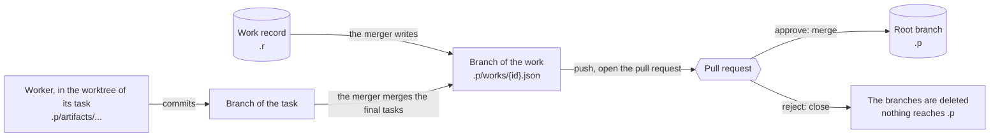
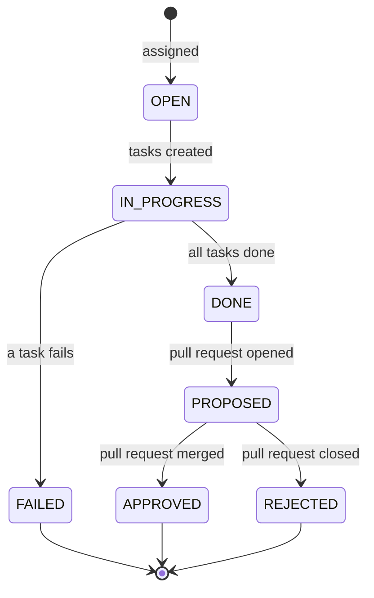

# Data flow

Where each piece of data is created, where it is read, and how it moves from one
place to another over time. It is a dynamic view: `storage.md` is the contract
of the data (the entities and the paths), and this document follows the data
through the system.

The rules of this document are those of `action-flow.md`: it points to the
documents of the parts, and it does not describe a part.

## Where the data is

| Data               | Where                                          | Created by                                                   | Read by                                                              |
| ------------------ | ---------------------------------------------- | ------------------------------------------------------------ | -------------------------------------------------------------------- |
| Workflow           | `.superteam/.p/workflows/{name}.json`          | The Seed Skill (see `seed-skill.md`)                         | The engine, when it assigns a work                                   |
| Role of Claude     | `.claude/agents/{role}.md`                     | The Seed Skill. The merger's file comes with the plugin      | The Claude process (see `claude-process.md`)                         |
| Work (record)      | `.superteam/.r/works/{id}.json`                | The handlers of the engine (see `handlers.md`)               | The handlers, to build the prompts and to survive a restart. The API |
| Task               | `.superteam/.r/tasks/{work_id}/{task_id}.json` | The handlers of the engine                                   | The handlers. The API, to derive the status of a work                |
| Work (persistence) | `.superteam/.p/works/{id}.json`                | The merger, in the worktree of the work                      | Whoever reads the root branch, such as the list of the works         |
| Artifact           | `.superteam/.p/artifacts/{work_id}/{id}.json`  | A script that the worker runs, in the worktree of its task   | Whoever reads the root branch, and the tasks that depend on its task |
| Pid and job        | `.superteam/.r/agents/{pid}.pid`               | The agent manager (see `agent-manager.md`)                   | The agent manager, to recover after a crash                          |
| Events             | `.superteam/.r/engineloop/`                    | The engine loop (see `engineloop.md`)                        | The engine loop                                                      |
| Worktrees          | `.superteam/.r/worktrees/`                     | The handlers, through the git adapter (see `git-adapter.md`) | The jobs that run in them                                            |

## How the persistence data reaches the root branch

The engine does not create persistence data directly (see the principles in
`architecture.md`). It is created in a worktree, kept on a branch, and it
reaches the root branch only when the pull request of the work is merged.

## Status of a work

The work status and the approval status are two separate statuses (see "Derived
status" in `storage.md`). Put in order, they make the whole life of a work, from
the moment it is assigned to its final result.

## Open questions

These are not decided yet.

1. **The record of a work.** The engine records the work at the assignment (see
   "Assign and run a work" in `action-flow.md`), but the rejection also creates
   a record in the runtime storage. Does the record exist from the assignment,
   and is it kept after an approval, when the work is in git?
2. **The artifacts and the tasks.** An artifact in git refers to a task, but the
   tasks are runtime data, and are not kept.
