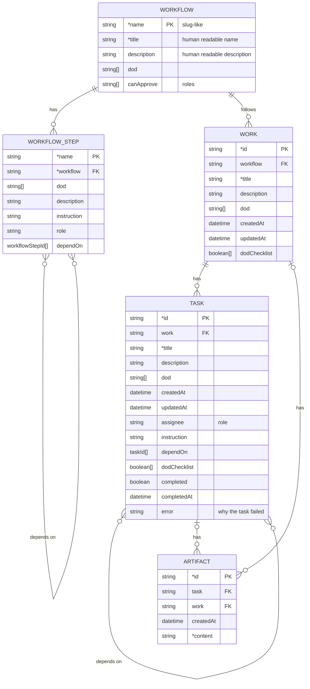
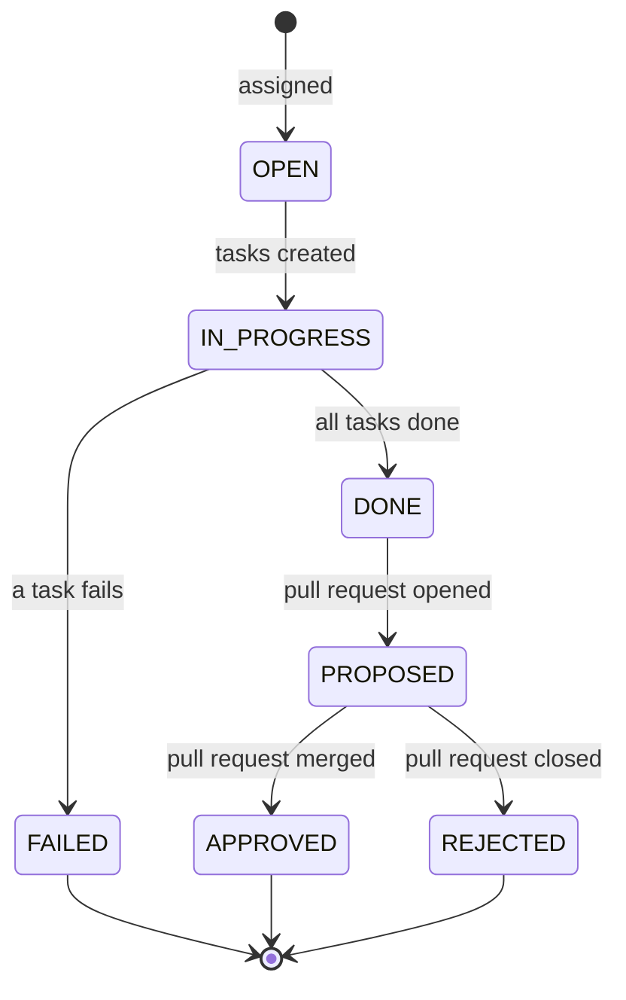

# Storage

Where the data is kept, and the entities that it holds. The engine that uses the
storage is in `engine.md`.

The storage is file-based, under `{baseDir}/.superteam/`, where `baseDir` is the
root workspace, the place where the engine runs. The data has two kinds (see the
principles in `architecture.md`), and each kind has one folder:

| Folder           | Kind        | In git |
| ---------------- | ----------- | ------ |
| `.superteam/.p/` | Persistence | Yes    |
| `.superteam/.r/` | Runtime     | No     |

An entity is one JSON file, and its path comes from its identity.

The persistence data is in `persistence-data.md`, and the runtime data is in
`runtime-data.md`.

## Data structure

A field whose name starts with `*` is required.

### Entity design

Entities are isolated: each one works on its own. An entity does not hold data
that is written back by an entity that refers to it, and the references between
entities never form a circle. So it is rare that more than one actor writes the
same entity.

### Roles

A role names a job. There are two kinds of role (see the principles in
`architecture.md`):

- **The roles of the engine:** the merger and the approver. The engine defines
  them.
- **The roles of the project:** such as the developer and the business analyst.
  The project defines them.

The fields `WORKFLOW_STEP.role`, `TASK.assignee` and `WORKFLOW.canApprove` hold
the names of roles. A job of a role can be done by a person or by an AI. So the
approver is a person or a bot.

### Derived status

These statuses are not stored. They are derived from the fields of the entities.

#### Task status

| Status        | Formula                                           |
| ------------- | ------------------------------------------------- |
| `PENDING`     | `depend_tasks_not_done.length > 0`                |
| `IN_PROGRESS` | `depend_tasks_not_done.length == 0 && !completed` |
| `DONE`        | `completed && !error`                             |
| `FAILED`      | `completed && error`                              |

`depend_tasks_not_done` is the tasks in `dependOn` that are not `DONE`. A task
that failed is `completed`, because its run has ended, and its `error` is the
reason. So a task that depends on a failed task stays `PENDING`.

#### Work status

| Status        | Formula                                                                                   |
| ------------- | ----------------------------------------------------------------------------------------- |
| `OPEN`        | `tasks.length == 0`                                                                       |
| `IN_PROGRESS` | `tasks.length > 0 && tasks.length > completed_tasks.length && failed_tasks.length == 0`   |
| `DONE`        | `tasks.length > 0 && tasks.length === completed_tasks.length && failed_tasks.length == 0` |
| `FAILED`      | `failed_tasks.length > 0`                                                                 |

`failed_tasks` is the tasks that are `FAILED`.

#### Work approval status

The approval status of a work is derived from its tasks and from its pull
request. The decision of the approver is not stored: the merge of the pull
request into the root branch is the approval, and the git history keeps it. A
failed work is never proposed, so it has no pull request, and its approval
status stays `DRAFT`.

| Approval status | Formula                                                                                                         |
| --------------- | --------------------------------------------------------------------------------------------------------------- |
| `DRAFT`         | `tasks.length === 0 \|\| tasks.length > completed_tasks.length \|\| failed_tasks.length > 0`                    |
| `PROPOSED`      | `tasks.length > 0 && tasks.length === completed_tasks.length && failed_tasks.length == 0 && pr.state == "open"` |
| `APPROVED`      | `pr.state == "merged"`                                                                                          |
| `REJECTED`      | `pr.state == "closed"`, which means closed without a merge                                                      |

`pr` is the pull request of the work, and `pr.state` is its state in git:
`open`, `merged`, or `closed` without a merge. A work that is not proposed has
no pull request.

#### Life of a work

The work status and the approval status are two separate statuses. Put in order,
they make the whole life of a work, from the moment it is assigned to its final
result.

## Open questions

These are not decided yet.

1. **The record of a work.** Its fields. The path above is a proposal.
2. **The identity.** The format of `id` for a work and a task: a counter, a
   random id, or a slug. The path comes from it. The `id` of an artifact is
   decided (see "Artifacts").
